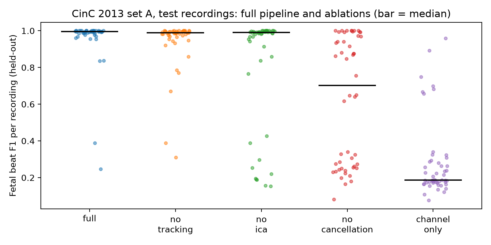
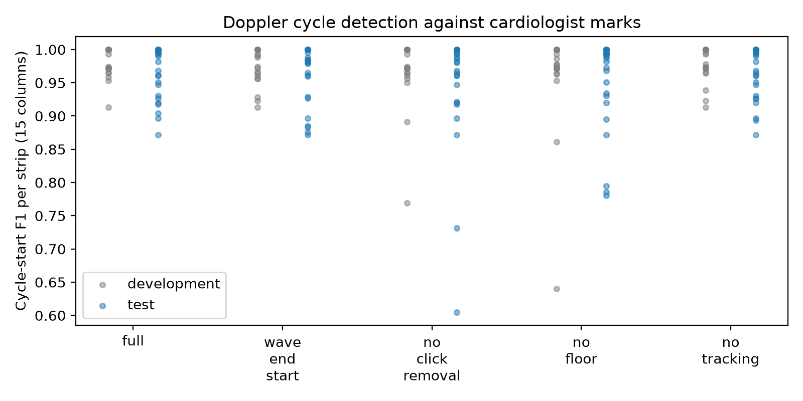
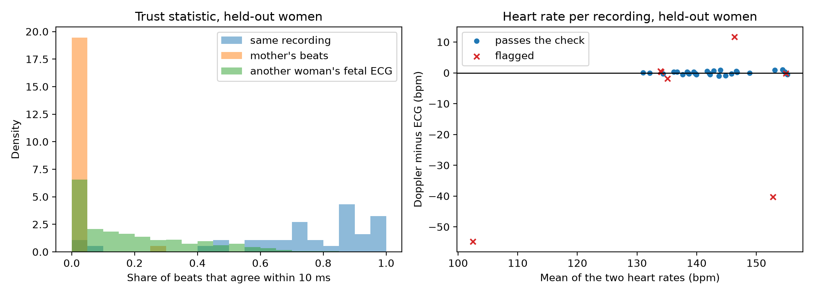
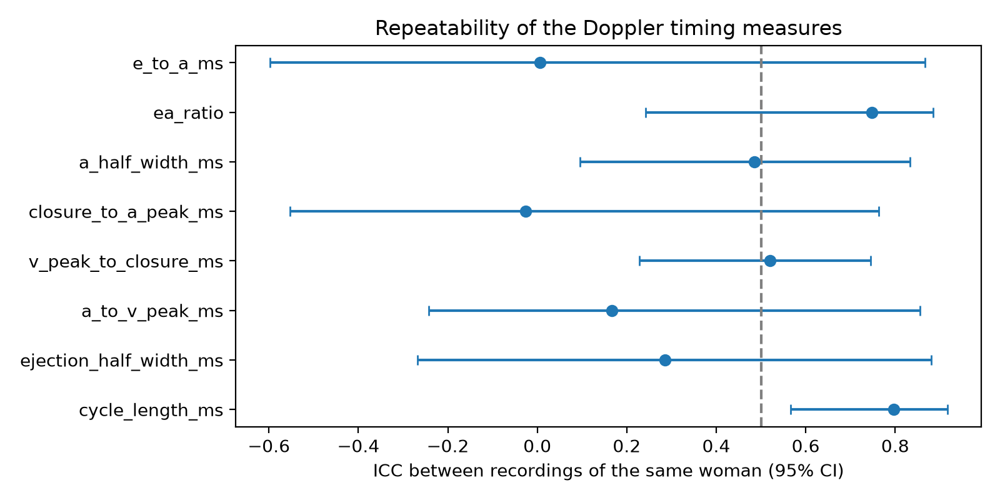
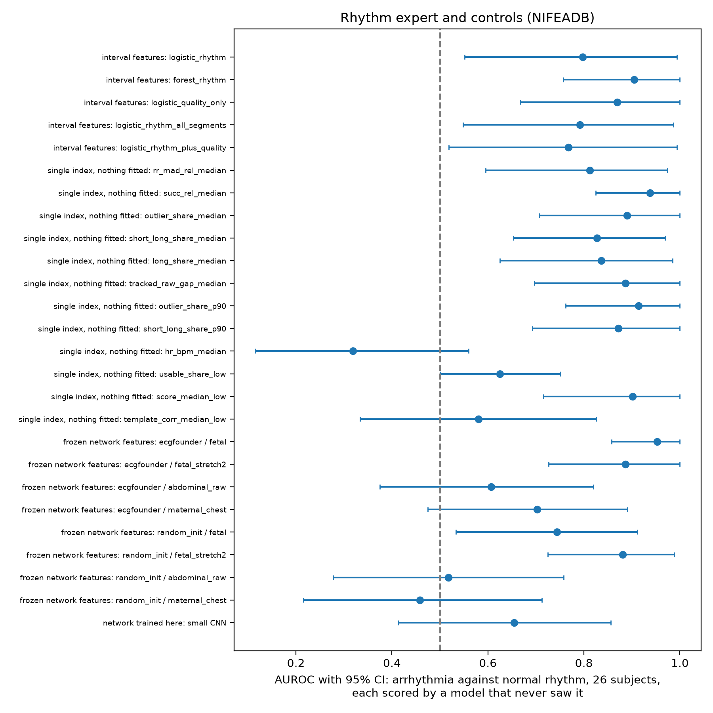
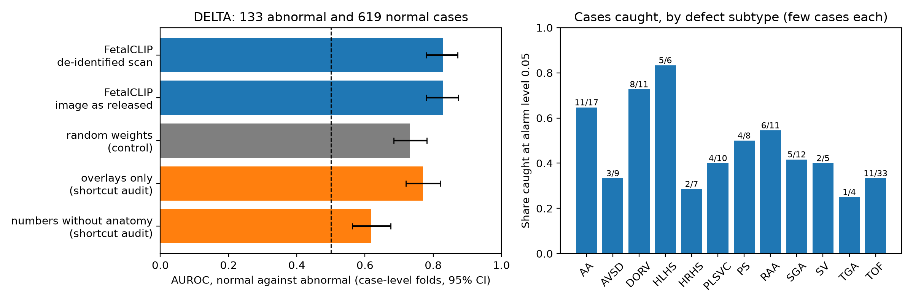
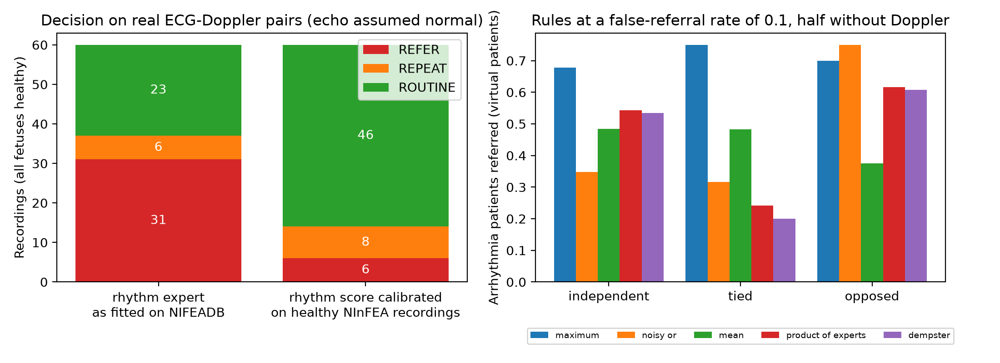
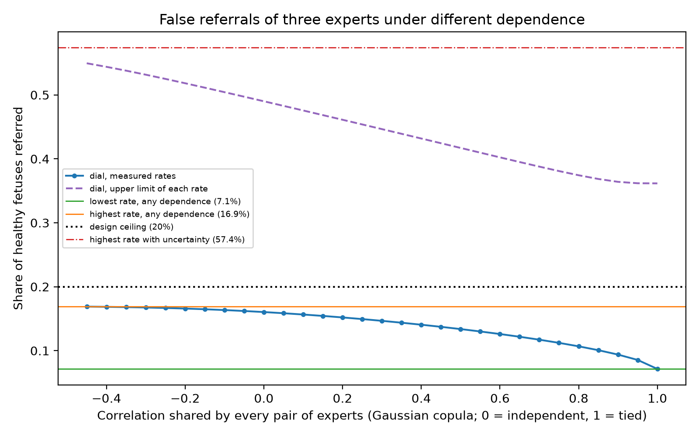
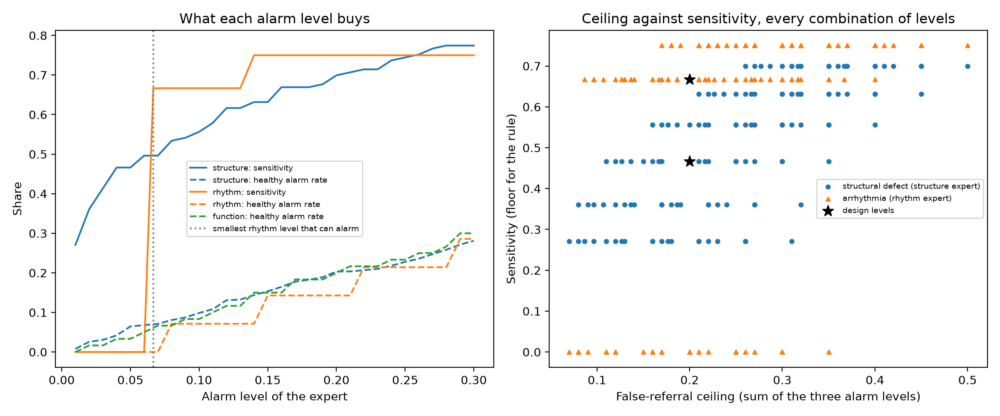
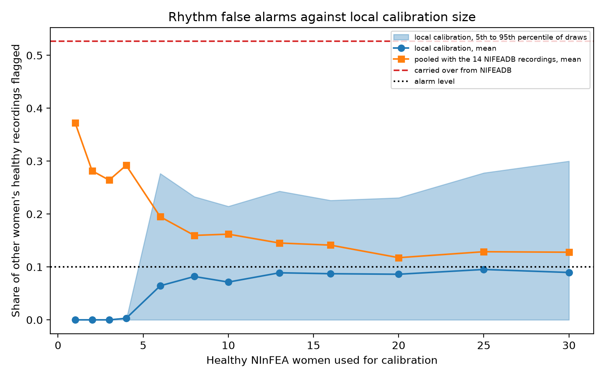

# Results of the rebuild

Generated by `scripts/build_report.py` from the run folders under `runs/`. Do not edit by hand: change the analysis, re-run it, and rebuild. Tables are also saved as CSV in `reports/tables/`, figures in `reports/figures/`, and `reports/manifest.json` lists the runs behind every file.

## Claim ledger

Every claim of the project in one table, generated from the run folders. 'Confirmatory' rows were tested as planned before the held-out data were used; 'exploratory' rows were added after the results were known (sections 9 to 12) and their intervals are not corrected for the number of checks, so read them as exploratory only.

| Claim | Kind | n | Estimate [95% CI] | Dataset | Run | Would be overturned by |
|---|---|---|---|---|---|---|
| Fetal beats are found without following the mother | confirmatory: split, model and level fixed before the held-out data | 50 test recordings | median F1 0.995 [0.993, 0.997] | CinC 2013 set A | wp1_cinc2013 | failing the gate on new recordings (median F1 >= 0.90 and follows-mother rate <= 0.05 on the held-out test recordings) |
| Cardiac cycles are found on Doppler strips | confirmatory: split, model and level fixed before the held-out data | 24 test strips, 1595 marks | mean F1 0.963 [0.946, 0.978] | annotated NInFEA strips | wp2_doppler_cycles | failing the gate on new strips (on the held-out strips: median F1 >= 0.90 at 15 columns, and Doppler rate within 5 bpm of the marked rate in >= 90% of strips) |
| The trust check tells a real ECG-Doppler pair from the mother's beats | confirmatory: split, model and level fixed before the held-out data | 37 recordings of 26 test women | AUROC 0.984 [0.946, 1.000] | NInFEA | wp3_trust_check | a simpler score separating them as well - heart rate alone reaches 0.966 [0.888, 1.000] (section 12.3) |
| ECG and Doppler beat-to-beat rates agree within the target | confirmatory: split, model and level fixed before the held-out data | 26 test women | limits [-13.3, 13.3] bpm: **NOT met** | NInFEA | wp3_trust_check | already falsified: gate G3 is not met |
| The rhythm expert separates arrhythmia from normal rhythm (feasibility on 26 recordings) | confirmatory: split, model and level fixed before the held-out data | 26 recordings (12 arrhythmia) | AUROC 0.798 [0.552, 0.994] | NIFEADB | wp4b_rhythm_intervals | AUROC near 0.5 on recordings of both classes from one recording setting (the 22 recordings from one setting give 0.714 [0.375, 0.981], section 12.1) |
| The structure expert reads heart structure (upper bound only) | confirmatory: split, model and level fixed before the held-out data | 752 cases (133 with a defect) | AUROC 0.828 [0.779, 0.871] | DELTA (one centre) | wp5_structure_delta | inputs without heart anatomy scoring as high (they reach 0.619 to 0.770); AUROC near 0.5 inside one image-size group or on a second dataset (642x506: 0.527 [0.283, 0.761], section 12.2); on Heartbeat it reached 0.509 [0.435, 0.583] (section 13.2) |
| The function expert flags healthy fetuses at no more than its level | confirmatory: split, model and level fixed before the held-out data | 60 healthy recordings | 2 flagged at 0.05 [0.0%, 8.8%] (by woman) | NInFEA (healthy only) | wp2b_function_reference | more flagged than the level on new healthy recordings; its sensitivity is unknown |
| False referrals stay under the ceiling when each expert is calibrated where it is used | confirmatory: split, model and level fixed before the held-out data | 60 real ECG-Doppler pairs | 10.0% [3.8%, 20.5%] (ceiling 15%) | NInFEA | wp6_fusion | healthy pairs from a new setting referred above the ceiling after local calibration |
| Calibration carried over from another device does not hold | confirmatory: split, model and level fixed before the held-out data | 60 real ECG-Doppler pairs | 51.7% [38.4%, 64.8%] referred | NIFEADB to NInFEA | wp6_fusion | carried-over calibration staying at its level on other devices |
| The structure expert reads heart structure in another country's data | confirmatory: preregistered on 20 Oct 2026, data seen only afterwards (clarifications of 27 Oct) | 784 patients (50 with CHD) | AUROC 0.509 [0.435, 0.583]: does not support it | Heartbeat, 2nd trimester (Colombia) | wp11_external_echo_heartbeat_2T | already falsified for the frozen DELTA expert (section 13.2) |
| The structure expert's DELTA alarm level holds in another country's data | confirmatory: preregistered on 20 Oct 2026, data seen only afterwards (clarifications of 27 Oct) | 734 normal patients | 94 flagged (12.8%) [10.5%, 15.4%] at level 0.05 | Heartbeat, 2nd trimester | wp11_external_echo_heartbeat_2T | already falsified: the interval excludes the level |
| Local calibration repairs the echo expert's false alarms but not its detection | exploratory: made after seeing the results; interval not corrected for the number of checks | 734 healthy and 50 CHD patients | false alarms within the level from 19 local healthy patients; 4.3% of CHD caught then | Heartbeat, 2nd trimester | wp17_structure_calibration | detection well above the level after local calibration |
| The echo expert gives the same answer for the same fetus scanned twice | exploratory: made after seeing the results; interval not corrected for the number of checks | 294 fetuses (2nd and 3rd trimester) | Spearman 0.05 [-0.07, 0.17] | Heartbeat | wp18_echo_retest | already falsified: the two scores do not agree |
| The Heartbeat images, labels and splits are read as the authors intended | exploratory: made after seeing the results; interval not corrected for the number of checks | 61 test patients, 6 released models | Heart-ViT AUROC 0.886, sensitivity 79.2%, specificity 93.2%; every published test metric within 0.007 points | Heartbeat, 2nd-trimester test set | wp15_reference_models | a released model missing its published result by more than 0.5 points |
| False referrals of three experts for any dependence (Frechet range) | exploratory: made after seeing the results; interval not corrected for the number of checks | measured rates of each expert | [7.1%, 16.9%]; with uncertainty [4.5%, 57.4%] | three datasets | wp7_dependence_bounds | a joint rate on paired patients outside the range |
| With 14 calibration recordings the rhythm level acts as a multiple of 1/15 | exploratory: made after seeing the results; interval not corrected for the number of checks (arithmetic) | 14 calibration recordings | effective level 0.067; effective ceiling 16.7% | NIFEADB | wp8_tradeoff | none: it follows from the p-value formula |
| The rhythm expert does not rely on the sampling rate itself | exploratory: made after seeing the results; interval not corrected for the number of checks | 26 recordings, all brought to 500 Hz | AUROC 0.810 [0.581, 0.994]; change 0.012 [0.000, 0.054] | NIFEADB | wp4e_rhythm_500hz | AUROC falling after the common 500 Hz step; the recording setting itself is not removed by resampling |
| Calibrating inside each image-size group does not restore detection at 642x506 | exploratory: made after seeing the results; interval not corrected for the number of checks | 11 defects at 642x506 | caught 0 of 11 | DELTA | wp5c_structure_by_size | defects caught there once calibrated in-group |
| A plain pulse-train cross-correlation tells swapped pairs apart better than the locked share | exploratory: made after seeing the results; interval not corrected for the number of checks | test women | AUROC difference (locked minus cross-correlation) -0.058 [-0.106, -0.022] | NInFEA | wp3b_trust_baselines | the difference interval covering 0 on new recordings |
| Local calibration keeps rhythm false alarms near the level from a modest number of healthy recordings | exploratory: made after seeing the results; interval not corrected for the number of checks | 57 recordings of 37 women | about 10 women (15 recordings) | NIFEADB to NInFEA (one device pair) | wp13_calibration_transfer | another device pair needing far more; sensitivity after local calibration is unknown |
| Splitting the same false-referral ceiling differently adds true referrals | exploratory: made after seeing the results; interval not corrected for the number of checks | levels chosen on half the people, valued on the other half | 0.23 per 1000 [-0.26, 0.71] | DELTA and NIFEADB, assumed prevalences | wp10_allocation | an interval covering 0 (a gain too small to matter) |

## Gates

| Gate | Outcome | Rule | Run | Code hash | Run time (UTC) |
|---|---|---|---|---|---|
| G1 | met | median F1 >= 0.90 and follows-mother rate <= 0.05 on the held-out test recordings | wp1_cinc2013 | fe14c714b7e8 | 2026-10-27T20:23:46+00:00 |
| G2 | met | on the held-out strips: median F1 >= 0.90 at 15 columns, and Doppler rate within 5 bpm of the marked rate in >= 90% of strips | wp2_doppler_cycles | fe14c714b7e8 | 2026-10-27T20:27:30+00:00 |
| G3 | NOT met | test women: beat-to-beat Bland-Altman limits within +-10 bpm in recordings that pass the ECG quality check, and AUROC >= 0.90 for maternal substitution | wp3_trust_check | fe14c714b7e8 | 2026-10-27T20:29:26+00:00 |
| G4 | met | every row has n, an interval and a run folder; the checkpoint hash matches the published file; the negative-control rows are present | wp4c_foundation | fe14c714b7e8 | 2026-10-27T20:46:49+00:00 |
| G5 | met on Heartbeat: the released Heart-ViT was reproduced (run wp15_reference_models), and patient-level AUROC with an interval and the shortcut audit are reported (run wp5_structure_heartbeat_2T); on DELTA no released model exists | the released reference model reproduced; pooled patient-level AUROC with an interval; shortcut audit reported | wp5_structure_delta | fe14c714b7e8 | 2026-10-27T21:05:20+00:00 |
| G6 | decided by the property tests (python -m pytest tests/test_fusion.py) | all property tests pass; every table row states how many scores are real, how many virtual, and which coupling | wp6_fusion | fe14c714b7e8 | 2026-10-27T21:31:41+00:00 |
| G7 | at the measured rates met ([7.1%, 16.9%]); with uncertainty NOT met ([4.5%, 57.4%]); gate defined after seeing the results | the false-referral range for any dependence lies inside the design ceiling (sum of the alarm levels); three experts, each at its alarm rate on its own healthy data | wp7_dependence_bounds | fe14c714b7e8 | 2026-10-27T21:33:12+00:00 |

## 1. Fetal beat detection (CinC 2013 set A)

Gate G1 (median F1 >= 0.90 and follows-mother rate <= 0.05 on the held-out test recordings): **met** - median F1 0.995, follows-the-mother rate 0.0%.

| Pipeline | Split | n | Mean F1 [95% CI] | Median F1 | F1 >= 0.9 | Follows the mother | Median rate error (bpm) |
|---|---|---|---|---|---|---|---|
| full | development | 25 | 0.965 [0.945, 0.983] | 0.993 | 84% | 0/25 | 0.19 |
| full | test | 50 | 0.958 [0.915, 0.989] | 0.995 | 92% | 0/50 | 0.07 |
| full | test without doubted references | 43 | 0.993 [0.990, 0.995] | 0.996 | 100% | 0/43 | 0.00 |
| no_tracking | development | 25 | 0.916 [0.873, 0.957] | 0.985 | 64% | 0/25 | 0.19 |
| no_tracking | test | 50 | 0.942 [0.901, 0.975] | 0.988 | 88% | 0/50 | 0.15 |
| no_tracking | test without doubted references | 43 | 0.980 [0.967, 0.990] | 0.993 | 95% | 0/43 | 0.15 |
| no_ica | development | 25 | 0.963 [0.941, 0.982] | 0.993 | 80% | 0/25 | 0.26 |
| no_ica | test | 50 | 0.830 [0.737, 0.907] | 0.990 | 74% | 5/50 | 0.16 |
| no_ica | test without doubted references | 43 | 0.857 [0.768, 0.936] | 0.993 | 79% | 5/43 | 0.16 |
| no_cancellation | development | 25 | 0.658 [0.543, 0.784] | 0.799 | 40% | 2/25 | 1.85 |
| no_cancellation | test | 50 | 0.626 [0.532, 0.719] | 0.703 | 36% | 1/50 | 1.13 |
| no_cancellation | test without doubted references | 43 | 0.635 [0.534, 0.737] | 0.755 | 37% | 1/43 | 1.17 |
| channel_only | development | 25 | 0.356 [0.238, 0.486] | 0.187 | 20% | 19/25 | 40.21 |
| channel_only | test | 50 | 0.280 [0.225, 0.338] | 0.186 | 2% | 29/50 | 49.23 |
| channel_only | test without doubted references | 43 | 0.276 [0.225, 0.341] | 0.187 | 2% | 25/43 | 45.76 |

## 2. Cardiac cycles on Doppler strips (annotated set)

Gate G2 (on the held-out strips: median F1 >= 0.90 at 15 columns, and Doppler rate within 5 bpm of the marked rate in >= 90% of strips): **met** - median F1 0.975, rate within the limit in 100% of held-out strips.

Held-out strips grouped by woman (16 women): mean F1 0.963 [0.944, 0.979], lowest 0.897.

Display orientation from the Doppler alone: 23/24 held-out strips correct (95% CI [0.79, 1.00]; wrong: [29]); development 18/19.

Agreement of a per-cycle similarity index with the cardiologist's choice of measurable cycles (held-out strips with at least five cycles of each kind, n = 14): median AUROC 0.68, range 0.31 to 1.00 - weak.

| Detector | Split | Strips | Marks | Mean F1 at 15 columns [95% CI] | Median | Lowest strip | Mean F1 at 25 columns | Recall | Recall, hand-placed marks | Rate within 5 bpm |
|---|---|---|---|---|---|---|---|---|---|---|
| full | development | 19 | 1241 | 0.979 [0.969, 0.989] | 0.974 | 0.913 | 0.994 | 0.977 | 0.976 | 18/18 |
| full | test | 24 | 1595 | 0.963 [0.946, 0.978] | 0.975 | 0.872 | 0.987 | 0.966 | 0.970 | 24/24 |
| wave_end_start | development | 19 | 1241 | 0.973 [0.960, 0.985] | 0.974 | 0.913 | 0.994 | 0.978 | 0.984 | 18/18 |
| wave_end_start | test | 24 | 1595 | 0.960 [0.940, 0.976] | 0.981 | 0.872 | 0.988 | 0.961 | 0.968 | 24/24 |
| no_click_removal | development | 19 | 1241 | 0.965 [0.939, 0.986] | 0.972 | 0.769 | 0.981 | 0.973 | 0.968 | 18/18 |
| no_click_removal | test | 24 | 1595 | 0.941 [0.901, 0.973] | 0.974 | 0.605 | 0.980 | 0.939 | 0.964 | 24/24 |
| no_floor | development | 19 | 1241 | 0.958 [0.916, 0.986] | 0.977 | 0.640 | 0.973 | 0.964 | 0.956 | 18/18 |
| no_floor | test | 24 | 1595 | 0.947 [0.918, 0.974] | 0.984 | 0.780 | 0.977 | 0.955 | 0.966 | 24/24 |
| no_tracking | development | 19 | 1241 | 0.977 [0.965, 0.989] | 0.978 | 0.913 | 0.989 | 0.970 | 0.967 | 18/18 |
| no_tracking | test | 24 | 1595 | 0.961 [0.944, 0.977] | 0.966 | 0.872 | 0.985 | 0.960 | 0.964 | 24/24 |

## 3. ECG-Doppler trust check (NInFEA, real pairs)

Gate G3 (test women: beat-to-beat Bland-Altman limits within +-10 bpm in recordings that pass the ECG quality check, and AUROC >= 0.90 for maternal substitution): **NOT met**. Beat-to-beat limits of agreement [-13.3, 13.3] bpm (agreement part NOT met); AUROC for the mother's beats 0.984 (detection part met).

Held-out recordings that pass the extractor's own quality check: 35 of 37. In them, 2560 paired intervals: median absolute difference 3.7 ms, 76.9% within 10 ms, 84.5% within 20 ms. The differences have heavy tails, so the classical limits are wide although most beats agree closely.

Recordings not passing the check (held-out): 9 (beats not locked; rates drift apart); 12 (beats not locked; rates drift apart; delay outside the physiological range); 13 (beats not locked); 15 (beats not locked); 16 (delay outside the physiological range); 18 (beats not locked; rates drift apart); 42 (beats not locked).

Cycle start at the valve closure click against the end of the ejection wave: median locked share 0.76 against 0.62; the click is better in 32 of 37 held-out recordings.

R peak to valve closure in passing held-out recordings: median 205 ms (range 133 to 274 ms).

Display orientation where it is known (held-out, n = 15): from the ECG 14 correct, from the Doppler alone 14 correct; the two methods agree on 20 of 22 strips of unknown orientation.

Robust agreement, added after seeing the result (run wp9_checks_after_results, recomputed from the beat times saved by this run): of the same 2560 beat pairs, the absolute interval difference has median 3.7 ms, 90th percentile 38.5 ms and 95th percentile 60.8 ms. On the 2482 plausible pairs the absolute rate difference has median 1.2 bpm, 90th percentile 10.2 bpm and 95th percentile 15.8 bpm; 89.9% lie within ±10 bpm. Percentile limits of agreement (2.5th to 97.5th percentile, this run): [-16.6, 15.5] bpm, wider than the classical limits [-13.3, 13.3] bpm. Gate G3 keeps its pre-specified rule and stays not met.

| Version | Split | Recordings | Women | Pass the check | AUROC vs mother's beats [95% CI] | AUROC vs another woman's ECG [95% CI] | Mother's beats flagged | Swaps flagged | Rate limits, all (bpm) | Rate limits, passing (bpm) |
|---|---|---|---|---|---|---|---|---|---|---|
| first held-out run (as pre-specified) | development | 23 | 13 | 18/23 | 0.998 [0.975, 1.000] | 0.960 [0.914, 0.993] | 23/23 | 478/482 | [-6.3, 7.7] | [-0.7, 1.1] |
| first held-out run (as pre-specified) | test | 37 | 26 | 28/37 | 0.956 [0.902, 1.000] | 0.878 [0.790, 0.950] | 37/37 | 1213/1238 | [-31.5, 32.0] | [-0.9, 1.0] |
| revised extractor | development | 23 | 13 | 18/23 | 0.998 [0.975, 1.000] | 0.960 [0.914, 0.993] | 23/23 | 478/482 | [-6.3, 7.7] | [-0.7, 1.1] |
| revised extractor | test | 37 | 26 | 30/37 | 0.984 [0.946, 1.000] | 0.919 [0.847, 0.974] | 37/37 | 1210/1238 | [-24.4, 19.9] | [-1.0, 1.0] |

| Rate difference between the two fetuses (bpm) | Flagged | Pairs | Share |
|---|---|---|---|
| 0-1 | 82 | 96 | 85.4% |
| 1-2 | 65 | 78 | 83.3% |
| 2-4 | 158 | 159 | 99.4% |
| 4-8 | 306 | 306 | 100.0% |
| 8-more | 599 | 599 | 100.0% |

| Alteration of the fetal beat series | Size | Cases | Flagged | Median locked share |
|---|---|---|---|---|
| shift | 0.05 | 30 | 26.7% | 0.89 |
| shift | 0.1 | 30 | 73.3% | 0.89 |
| shift | 0.15 | 30 | 100.0% | 0.89 |
| shift | 0.2 | 30 | 100.0% | 0.89 |
| shift | 0.3 | 30 | 86.7% | 0.89 |
| shift | 0.5 | 30 | 66.7% | 0.83 |
| shift | 1.0 | 30 | 86.7% | 0.73 |
| shift | 2.0 | 30 | 70.0% | 0.68 |
| drop | 0.1 | 150 | 24.7% | 0.69 |
| drop | 0.2 | 150 | 81.3% | 0.53 |
| drop | 0.3 | 150 | 98.0% | 0.38 |
| drop | 0.5 | 150 | 100.0% | 0.19 |
| jitter | 2.0 | 150 | 4.7% | 0.83 |
| jitter | 5.0 | 150 | 26.7% | 0.68 |
| jitter | 10.0 | 150 | 79.3% | 0.44 |
| jitter | 20.0 | 150 | 100.0% | 0.25 |

## 4. Function expert: Doppler timing in healthy fetuses (NInFEA)

All fetuses are healthy. The numbers describe false alarms and repeatability only; no sensitivity is measured.

Usable recordings: 60 of 60 (39 women). Smallest p-value possible with this many healthy recordings: 0.017.

The shift table is a simulation: a measured healthy value plus a stated shift of one interval. It shows what size of change the reference could flag, not what disease looks like.

| Measure | Readable | Median [quartiles] | First half vs second half, median abs. difference | ICC between recordings of a woman [95% CI] | Women with repeats | Within-woman SD |
|---|---|---|---|---|---|---|
| cycle_length_ms | 60/60 | 428.83 [410.34, 444.12] | 6.42 | 0.80 [0.57, 0.92] | 19 | 9.18 |
| ejection_half_width_ms | 60/60 | 138.38 [122.24, 163.14] | 7.24 | 0.29 [-0.27, 0.88] | 19 | 47.51 |
| a_to_v_peak_ms | 60/60 | 134.93 [120.54, 145.90] | 3.96 | 0.17 [-0.24, 0.86] | 19 | 21.00 |
| v_peak_to_closure_ms | 60/60 | 124.14 [115.82, 130.62] | 5.30 | 0.52 [0.23, 0.74] | 19 | 9.10 |
| closure_to_a_peak_ms | 60/60 | 164.03 [154.04, 181.76] | 8.29 | -0.03 [-0.55, 0.76] | 19 | 24.12 |
| a_half_width_ms | 58/60 | 116.50 [73.18, 154.67] | 9.36 | 0.48 [0.10, 0.83] | 19 | 34.16 |
| ea_ratio | 34/60 | 0.72 [0.66, 0.76] | 0.05 | 0.75 [0.24, 0.88] | 8 | 0.04 |
| e_to_a_ms | 34/60 | 93.03 [87.38, 105.05] | 8.97 | 0.01 [-0.60, 0.87] | 8 | 16.00 |

| Alarm level | Flagged | Recordings | Share | 95% CI (by woman) | Women with a flagged recording |
|---|---|---|---|---|---|
| 0.05 | 2 | 60 | 3.3% | [0.000, 0.088] | 2/39 |
| 0.1 | 5 | 60 | 8.3% | [0.018, 0.153] | 5/39 |
| 0.2 | 12 | 60 | 20.0% | [0.100, 0.300] | 10/39 |

| Measure | Direction and alarm level | Shift flagged in half of the recordings (ms) | Shift flagged in 80% (ms) |
|---|---|---|---|
| a_to_v_peak_ms | longer alpha 0.05 | not within the range tried | not within the range tried |
| a_to_v_peak_ms | shorter alpha 0.05 | not within the range tried | not within the range tried |
| a_to_v_peak_ms | longer alpha 0.1 | 90 | not within the range tried |
| a_to_v_peak_ms | shorter alpha 0.1 | 95 | 120 |
| v_peak_to_closure_ms | longer alpha 0.05 | 55 | 65 |
| v_peak_to_closure_ms | shorter alpha 0.05 | 55 | 65 |
| v_peak_to_closure_ms | longer alpha 0.1 | 35 | 45 |
| v_peak_to_closure_ms | shorter alpha 0.1 | 35 | 45 |
| ejection_half_width_ms | longer alpha 0.05 | not within the range tried | not within the range tried |
| ejection_half_width_ms | shorter alpha 0.05 | not within the range tried | not within the range tried |
| ejection_half_width_ms | longer alpha 0.1 | not within the range tried | not within the range tried |
| ejection_half_width_ms | shorter alpha 0.1 | not within the range tried | not within the range tried |

## 5. Rhythm expert (NIFEADB, 12 arrhythmia and 14 normal)

Gate G4 (every row has n, an interval and a run folder; the checkpoint matches the published file; negative-control rows present): **met**.

Checkpoint: ECGFounder single-lead, file 1_lead_ECGFounder.pth, SHA-256 f863a38897fb49a2..., 30,807,750 parameters, loaded with strict key matching.

Usable one-minute segments: 148/156 in arrhythmia recordings, 140/140 in normal recordings; median extractor score 0.40 against 0.64.

The sampling-rate table was added after the first run showed the maternal-lead control above chance; it re-summarises the same out-of-fold scores and is a check made after seeing a result.

The small CNN was trained three times with different seeds; recording-level AUROC 0.655, 0.607, 0.565 (mean 0.609). The first is the run shown in the table; the spread is training noise.

| Group | Model or index | n | AUROC [95% CI] | p-value (method) | Sensitivity / specificity at 0.5 | Role or note | Run |
|---|---|---|---|---|---|---|---|
| interval features | logistic_rhythm | 26 | 0.798 [0.552, 0.994] | 0.0020 (refit, 500) | 0.58 / 1.00 |  | wp4b_rhythm_intervals |
| interval features | forest_rhythm | 26 | 0.905 [0.757, 1.000] | 0.0196 (refit, 50) | 0.75 / 0.86 |  | wp4b_rhythm_intervals |
| interval features | logistic_quality_only | 26 | 0.869 [0.667, 1.000] | 0.0020 (refit, 500) | 0.75 / 1.00 | extractor quality values only; its score includes rhythm regularity, so this is not a neutral control | wp4b_rhythm_intervals |
| interval features | logistic_rhythm_all_segments | 26 | 0.792 [0.549, 0.986] | 0.0080 (refit, 500) | 0.67 / 1.00 |  | wp4b_rhythm_intervals |
| interval features | logistic_rhythm_plus_quality | 26 | 0.768 [0.519, 0.994] | 0.0100 (refit, 500) | 0.67 / 1.00 |  | wp4b_rhythm_intervals |
| single index, nothing fitted | rr_mad_rel_median | 26 | 0.812 [0.595, 0.974] | 0.0045 (10000) | - |  | wp4b_rhythm_intervals |
| single index, nothing fitted | succ_rel_median | 26 | 0.938 [0.825, 1.000] | 0.0001 (10000) | - |  | wp4b_rhythm_intervals |
| single index, nothing fitted | outlier_share_median | 26 | 0.890 [0.706, 1.000] | 0.0003 (10000) | - |  | wp4b_rhythm_intervals |
| single index, nothing fitted | short_long_share_median | 26 | 0.827 [0.653, 0.969] | 0.0005 (10000) | - |  | wp4b_rhythm_intervals |
| single index, nothing fitted | long_share_median | 26 | 0.836 [0.625, 0.985] | 0.0016 (10000) | - |  | wp4b_rhythm_intervals |
| single index, nothing fitted | tracked_raw_gap_median | 26 | 0.887 [0.697, 1.000] | 0.0001 (10000) | - |  | wp4b_rhythm_intervals |
| single index, nothing fitted | outlier_share_p90 | 26 | 0.914 [0.762, 1.000] | 0.0001 (10000) | - |  | wp4b_rhythm_intervals |
| single index, nothing fitted | short_long_share_p90 | 26 | 0.872 [0.692, 1.000] | 0.0003 (10000) | - |  | wp4b_rhythm_intervals |
| single index, nothing fitted | hr_bpm_median | 26 | 0.318 [0.115, 0.560] | 0.9407 (10000) | - | no direction was pre-specified for heart rate; AUROC below 0.5 means arrhythmia recordings are slower | wp4b_rhythm_intervals |
| single index, nothing fitted | usable_share_low | 26 | 0.625 [0.500, 0.750] | 0.0799 (10000) | - | share of usable segments (lower = arrhythmia) | wp4b_rhythm_intervals |
| single index, nothing fitted | score_median_low | 26 | 0.902 [0.716, 1.000] | 0.0001 (10000) | - | extractor score (lower = arrhythmia); it includes rhythm regularity, so it is not a neutral control | wp4b_rhythm_intervals |
| single index, nothing fitted | template_corr_median_low | 26 | 0.580 [0.333, 0.825] | 0.2501 (10000) | - | beat-shape consistency only (lower = arrhythmia): the neutral quality control | wp4b_rhythm_intervals |
| frozen network features | ecgfounder / fetal | 26 | 0.952 [0.858, 1.000] | 0.003 (refit, 300) | 0.83 / 0.86 | fetal input | wp4c_foundation |
| frozen network features | ecgfounder / fetal_stretch2 | 26 | 0.887 [0.726, 1.000] | 0.007 (refit, 300) | 0.83 / 0.86 | fetal input | wp4c_foundation |
| frozen network features | ecgfounder / abdominal_raw | 26 | 0.607 [0.375, 0.819] | 0.140 (refit, 300) | 0.75 / 0.50 | negative control | wp4c_foundation |
| frozen network features | ecgfounder / maternal_chest | 26 | 0.702 [0.475, 0.891] | 0.033 (refit, 300) | 0.67 / 0.64 | negative control | wp4c_foundation |
| frozen network features | random_init / fetal | 26 | 0.744 [0.533, 0.911] | 0.033 (refit, 300) | 0.58 / 0.71 | fetal input | wp4c_foundation |
| frozen network features | random_init / fetal_stretch2 | 26 | 0.881 [0.725, 0.988] | 0.003 (refit, 300) | 0.58 / 0.86 | fetal input | wp4c_foundation |
| frozen network features | random_init / abdominal_raw | 26 | 0.518 [0.278, 0.758] | 0.319 (refit, 300) | 0.50 / 0.57 | negative control | wp4c_foundation |
| frozen network features | random_init / maternal_chest | 26 | 0.458 [0.215, 0.712] | 0.468 (refit, 300) | 0.50 / 0.57 | negative control | wp4c_foundation |
| network trained here | small CNN | 26 | 0.655 [0.413, 0.856] | 0.095 (Mann-Whitney) | 0.67 / 0.57 |  | wp4d_cnn |

| Model | Segments of a recording on both sides [95% CI] | Recording held out [95% CI] | Inflation | Run |
|---|---|---|---|---|
| forest on segment features | 0.938 [0.843, 0.987] | 0.870 [0.709, 0.967] | 0.067 | wp4b_rhythm_intervals |
| logistic on segment features | 0.890 [0.759, 0.967] | 0.788 [0.539, 0.942] | 0.102 | wp4b_rhythm_intervals |
| small CNN on 10-second windows | 0.902 [0.833, 0.945] | 0.664 [0.457, 0.839] | 0.238 | wp4d_cnn |

| Network / input | Recordings | Mean abs. error, bpm [95% CI] | Error of predicting the mean | R squared | Spearman |
|---|---|---|---|---|---|
| ecgfounder / fetal | 75 | 4.12 [3.13, 5.24] | 10.06 | 0.75 | 0.88 |
| ecgfounder / fetal_stretch2 | 75 | 5.12 [4.01, 6.41] | 10.06 | 0.65 | 0.82 |
| random_init / fetal | 75 | 5.19 [3.99, 6.51] | 10.06 | 0.62 | 0.83 |
| random_init / fetal_stretch2 | 75 | 4.19 [3.20, 5.30] | 10.06 | 0.75 | 0.88 |

| Network / input | AUROC, all 26 | AUROC without the four 500 Hz recordings | n | Mean score, 500 Hz arrhythmia | Mean score, 1 kHz arrhythmia | Mean score, normal |
|---|---|---|---|---|---|---|
| ecgfounder / fetal | 0.952 | 0.946 | 22 | 0.93 | 0.74 | 0.12 |
| ecgfounder / fetal_stretch2 | 0.887 | 0.848 | 22 | 0.99 | 0.75 | 0.18 |
| ecgfounder / abdominal_raw | 0.607 | 0.562 | 22 | 0.84 | 0.62 | 0.49 |
| ecgfounder / maternal_chest | 0.702 | 0.598 | 22 | 0.88 | 0.52 | 0.41 |
| random_init / fetal | 0.744 | 0.670 | 22 | 0.87 | 0.46 | 0.30 |
| random_init / fetal_stretch2 | 0.881 | 0.902 | 22 | 0.62 | 0.72 | 0.20 |
| random_init / abdominal_raw | 0.518 | 0.518 | 22 | 0.49 | 0.51 | 0.49 |
| random_init / maternal_chest | 0.458 | 0.259 | 22 | 0.84 | 0.28 | 0.48 |

**Recordings sampled at 1 kHz only (added after seeing the results, run wp9_checks_after_results).** Sampling rates read from the record headers: 500 Hz: 4 arrhythmia, 0 normal; 1000 Hz: 8 arrhythmia, 14 normal. The same out-of-fold scores are evaluated without the 500 Hz recordings, with a bootstrap interval over subjects; nothing is re-fitted. The saved per-record files hold scores rounded to 6 decimals; a score is recomputed only if its AUROC over all 26 recordings equals the published value exactly.

| Score | AUROC, all 26 [95% CI] | AUROC, 1 kHz only [95% CI] | Recordings (1 kHz) |
|---|---|---|---|
| rhythm expert: interval features, logistic | 0.798 [0.552, 0.994] | 0.696 [0.347, 0.981] | 22 (8 arrhythmia) |
| interval features, random forest | 0.905 [0.757, 1.000] | 0.857 [0.653, 1.000] | 22 (8 arrhythmia) |
| single index: successive interval change | 0.938 [0.825, 1.000] | 0.906 [0.750, 1.000] | 22 (8 arrhythmia) |
| baseline: heart rate only (higher = arrhythmia) | 0.318 [0.115, 0.560] | 0.228 [0.018, 0.514] | 22 (8 arrhythmia) |
| baseline: heart rate only, lower = arrhythmia (direction chosen after seeing the data) | 0.682 [0.440, 0.885] | 0.772 [0.486, 0.982] | 22 (8 arrhythmia) |
| ECGFounder, fetal input | 0.952 [0.858, 1.000] | 0.946 [0.833, 1.000] | 22 (8 arrhythmia) |
| ECGFounder, fetal input stretched | 0.887 [0.726, 1.000] | 0.848 [0.616, 1.000] | 22 (8 arrhythmia) |
| random weights, fetal input | 0.744 (published) | not recomputed: rounding in the saved file ties scores of the two classes | - |
| random weights, fetal input stretched | 0.881 [0.725, 0.988] | 0.902 [0.750, 1.000] | 22 (8 arrhythmia) |
| ECGFounder, mother's chest lead (control) | 0.702 [0.475, 0.891] | 0.598 [0.342, 0.838] | 22 (8 arrhythmia) |

The network with random weights (stretched fetal input, 0.881 [0.725, 0.988]) overlaps the interval of ECGFounder (0.952 [0.858, 1.000]); their paired difference is 0.071 [-0.007, 0.185] (run wp9_checks_after_results, added after seeing the results), so the two cannot be ranked. On the 1 kHz recordings the rhythm expert fixed in the plan reaches 0.696 [0.347, 0.981]; the interval includes chance, so part of its AUROC on all 26 recordings may come from the sampling rate.

## 6. Structure expert (fetal echo)

Gate G5 (the released reference model reproduced; pooled patient-level AUROC with an interval; shortcut audit reported): **partly met** - the AUROC with its interval and the shortcut audit are reported; no released reference model exists for the dataset used. **The shortcut audit finds label information outside the heart**: probes that see little or no cardiac anatomy separate the classes well above chance (tables below). The structure expert's AUROC is therefore an upper bound on what heart structure contributes, not a measure of it.

### Labelled data: DELTA

Dataset: DELTA (figshare doi:10.6084/m9.figshare.32358771 (version 2), CC BY 4.0). 3760 still images of 752 cases: 133 abnormal, 619 normal. All images of a case stay on one side of every split. Probe, folds and alarm level were fixed in the script before any image was processed.

Model: FetalCLIP (SHA-256 90916caa408baf93..., 427,647,233 parameters, licence CC BY-NC 4.0), frozen; control: the same network with random weights.

Shortcut audit: an interval that excludes 0.5 means the label can be read without looking at the heart. Image size differs between the classes (table below), so the main probes are repeated inside the most common size.

The subtype table has few cases per row; it is descriptive only.

| Input to the probe | AUROC, repeated case-level folds [95% CI] | p-value (labels shuffled, probe refitted) | AUROC on the dataset's own test set [95% CI] | AUROC inside the most common image size, 900x752 [95% CI] |
|---|---|---|---|---|
| FetalCLIP, de-identified scan (the structure expert) | 0.828 [0.779, 0.871] | 0.005 | 0.878 [0.782, 0.950] | 0.870 [0.825, 0.911] |
| FetalCLIP, image as released | 0.828 [0.780, 0.874] | 0.005 | 0.862 [0.770, 0.937] | - |
| same network with random weights (control) | 0.733 [0.684, 0.781] | 0.005 | 0.820 [0.732, 0.893] | 0.736 [0.678, 0.791] |
| FetalCLIP, overlays only (shortcut audit) | 0.770 [0.720, 0.821] | 0.005 | 0.819 [0.713, 0.907] | - |
| six numbers without anatomy (shortcut audit) | 0.619 [0.563, 0.675] | 0.005 | 0.680 [0.548, 0.802] | 0.618 [0.556, 0.677] |

| Evaluation | Alarm level | Abnormal cases caught | Sensitivity | 95% CI | Normal cases flagged | False-alarm share | 95% CI |
|---|---|---|---|---|---|---|---|
| repeated case-level folds, all cases | 0.05 | 62/133 | 46.6% | [0.38, 0.55] | 40/619 | 6.5% | [0.047, 0.087] |
| dataset's own partition: fitted on Train, calibrated on Val, judged on Test | 0.05 | 18/30 | 60.0% | [0.41, 0.77] | 9/124 | 7.3% | [0.034, 0.133] |

| Plane used alone | Cases | Abnormal | AUROC [95% CI] |
|---|---|---|---|
| 3VT | 752 | 133 | 0.797 [0.747, 0.844] |
| 4CH | 752 | 133 | 0.835 [0.792, 0.875] |
| Abdomen | 752 | 133 | 0.771 [0.722, 0.820] |
| LVOT | 752 | 133 | 0.821 [0.773, 0.864] |
| RVOT | 752 | 133 | 0.778 [0.729, 0.825] |

| Defect subtype | Cases | Caught at the alarm level | 95% CI of the share |
|---|---|---|---|
| AA | 17 | 11 | [0.38, 0.86] |
| AVSD | 9 | 3 | [0.07, 0.70] |
| DORV | 11 | 8 | [0.39, 0.94] |
| HLHS | 6 | 5 | [0.36, 1.00] |
| HRHS | 7 | 2 | [0.04, 0.71] |
| PLSVC | 10 | 4 | [0.12, 0.74] |
| PS | 8 | 4 | [0.16, 0.84] |
| RAA | 11 | 6 | [0.23, 0.83] |
| SGA | 12 | 5 | [0.15, 0.72] |
| SV | 5 | 2 | [0.05, 0.85] |
| TGA | 4 | 1 | [0.01, 0.81] |
| TOF | 33 | 11 | [0.18, 0.52] |

| Image size | Normal cases | Abnormal cases | Abnormal share |
|---|---|---|---|
| 1114x766 | 6 | 1 | 14.3% |
| 448x404 | 0 | 1 | 100.0% |
| 642x506 | 112 | 11 | 8.9% |
| 744x658 | 15 | 1 | 6.2% |
| 806x648 | 69 | 5 | 6.8% |
| 900x752 | 417 | 114 | 21.5% |

**Checks made after seeing the results above** (run wp5b_structure_controls_delta): the overlay-only probe scored close to the structure expert, so the gap was measured on the same cases.

| Control | AUROC of the control | Structure expert minus control [95% CI, bootstrap over cases] | Interval excludes zero |
|---|---|---|---|
| FetalCLIP, overlays only (shortcut audit) | 0.770 | 0.057 [0.010, 0.105] | yes |
| same network with random weights (control) | 0.733 | 0.095 [0.043, 0.150] | yes |
| six numbers without anatomy (shortcut audit) | 0.619 | 0.209 [0.152, 0.261] | yes |
| FetalCLIP, image as released | 0.828 | -0.001 [-0.020, 0.019] | no |

Inside the 900x752 images (531 cases, 114 abnormal) the overlay-only probe reached 0.816 [0.762, 0.866] against 0.870 for the structure expert. At the alarm level 0.05, the structure expert caught 62 of 133 abnormal cases and the overlay-only probe 60; 45 were caught by both and 17 by the structure expert alone. The abdominal plane, which does not show the heart, reached 0.771 [0.722, 0.820] on its own (four-chamber plane 0.835 [0.792, 0.875]).

## 7. Fusion and decision

Decision settings: alarm levels {'structure': 0.05, 'function': 0.05, 'rhythm': 0.1}, priors {'structure': 0.009, 'function': 0.002, 'rhythm': 0.001} (function and rhythm priors are assumptions), a missing test is requested when its prior is above 0.005.

Real paired cohort, as it is (no echo exists in NInFEA): REFER 31, REPEAT 6, GET_TEST 23, ROUTINE 0 of 60 recordings. The second table replaces the missing echo by an assumed normal result to show the ECG-Doppler part alone; that is a stated assumption.

The rhythm expert was fitted on NIFEADB (other device, later gestation, 60-second segments). Its alarms on NInFEA measure how it travels, not a tuned false-alarm rate.

With the rhythm score calibrated locally, the second row of the cohort table shows false referrals of the two experts on real pairs of healthy fetuses, with both calibrated on healthy cases from the same setting. Sensitivity of this calibration is unknown: NInFEA has no arrhythmia.

Bounds on real scores, all three couplings: false-referral rate independent 10.2%, tied 6.7%, opposed 10.0% against the ceiling 15% (respected: True); sensitivity never below the rhythm expert alone (respected: True).

Hypothesis H7 (with mixed test availability and one threshold, averaging-type rules lose alarms that the OR rule keeps at the same false-referral rate): the mean rule had lower sensitivity than the OR rule in 6 of 6 mixed-availability rows, but the interval of the difference excluded zero in 0 rows. With 12 arrhythmia and 14 normal rhythm scores the comparison is not conclusive. That one alarm cannot be cancelled is a property of the rule and is tested in tests/test_fusion.py.

The rule comparison uses virtual patients made by pairing real held-out scores of different people. It is not a measurement of a fused system on patients.

| Expert | Alarm level | Abnormal cases caught | 95% CI of sensitivity | Healthy cases flagged | Smallest possible p |
|---|---|---|---|---|---|
| rhythm (NIFEADB, leave-one-subject-out) | 0.1 | 8/12 | [0.35, 0.90] | 1/14 | 0.067 |
| function (NInFEA, leave-one-woman-out) | 0.05 | no abnormal case | - | 2/60 | - |
| structure (DELTA, case-level folds) | 0.05 | 62/133 | [0.38, 0.55] | 40/619 | - |

| Calibration of the rhythm expert | Recordings | REFER (false) | REPEAT | ROUTINE | False-referral share | 95% CI | Alarms: rhythm / function | Ceiling from the alarm levels |
|---|---|---|---|---|---|---|---|---|
| rhythm expert as fitted on NIFEADB | 60 | 31 | 6 | 23 | 51.7% | [0.384, 0.648] | 30 / 2 | 0.15 |
| rhythm score calibrated on healthy NInFEA recordings of other women | 60 | 6 | 8 | 46 | 10.0% | [0.038, 0.205] | 5 / 2 | 0.15 |

| Target false-referral rate | Tests available | Coupling | Virtual arrhythmia patients | Real scores used | maximum: sensitivity [95% CI] | noisy or: sensitivity [95% CI] | mean: sensitivity [95% CI] | product of experts: sensitivity [95% CI] | dempster: sensitivity [95% CI] | maximum minus mean [95% CI] |
|---|---|---|---|---|---|---|---|---|---|---|
| 0.1 | both_tests | independent | 720 | 86 | 0.69 [0.02, 0.92] | 0.35 [0.18, 0.75] | 0.31 [0.18, 0.54] | 0.35 [0.19, 0.58] | 0.34 [0.18, 0.56] | 0.38 [-0.40, 0.56] |
| 0.1 | both_tests | tied | 60 | 86 | 0.67 [0.03, 0.92] | 0.22 [0.07, 0.55] | 0.18 [0.07, 0.42] | 0.22 [0.07, 0.48] | 0.18 [0.07, 0.45] | 0.48 [-0.16, 0.77] |
| 0.1 | both_tests | opposed | 60 | 86 | 0.73 [0.03, 0.99] | 0.83 [0.16, 1.00] | 0.77 [0.34, 0.97] | 0.77 [0.37, 0.94] | 0.77 [0.36, 0.95] | -0.03 [-0.82, 0.31] |
| 0.1 | mixed | independent | 1440 | 86 | 0.68 [0.02, 0.92] | 0.35 [0.19, 0.91] | 0.48 [0.02, 0.71] | 0.54 [0.17, 0.83] | 0.53 [0.18, 0.82] | 0.19 [-0.50, 0.36] |
| 0.1 | mixed | tied | 120 | 86 | 0.75 [0.02, 0.92] | 0.32 [0.09, 0.76] | 0.48 [0.03, 0.63] | 0.24 [0.08, 0.74] | 0.20 [0.09, 0.69] | 0.27 [-0.29, 0.40] |
| 0.1 | mixed | opposed | 120 | 86 | 0.70 [0.02, 0.96] | 0.75 [0.33, 0.96] | 0.38 [0.00, 0.81] | 0.62 [0.00, 0.89] | 0.61 [0.00, 0.88] | 0.33 [-0.34, 0.87] |
| 0.15 | both_tests | independent | 720 | 86 | 0.69 [0.03, 0.93] | 0.52 [0.29, 0.90] | 0.41 [0.24, 0.61] | 0.46 [0.28, 0.69] | 0.43 [0.27, 0.65] | 0.28 [-0.38, 0.51] |
| 0.15 | both_tests | tied | 60 | 86 | 0.75 [0.10, 0.92] | 0.30 [0.12, 0.75] | 0.22 [0.12, 0.50] | 0.27 [0.12, 0.59] | 0.23 [0.12, 0.55] | 0.53 [-0.08, 0.75] |
| 0.15 | both_tests | opposed | 60 | 86 | 0.75 [0.03, 1.00] | 0.85 [0.46, 1.00] | 0.80 [0.38, 0.97] | 0.77 [0.42, 0.92] | 0.77 [0.40, 0.95] | -0.05 [-0.70, 0.30] |
| 0.15 | mixed | independent | 1440 | 86 | 0.77 [0.02, 1.00] | 0.70 [0.31, 0.93] | 0.52 [0.33, 0.79] | 0.63 [0.23, 0.87] | 0.62 [0.37, 0.84] | 0.25 [-0.47, 0.32] |
| 0.15 | mixed | tied | 120 | 86 | 0.75 [0.03, 0.92] | 0.67 [0.21, 0.91] | 0.48 [0.33, 0.71] | 0.64 [0.14, 0.83] | 0.60 [0.16, 0.81] | 0.27 [-0.33, 0.37] |
| 0.15 | mixed | opposed | 120 | 86 | 0.82 [0.02, 0.96] | 0.81 [0.50, 0.96] | 0.51 [0.25, 0.90] | 0.71 [0.35, 0.91] | 0.70 [0.35, 0.90] | 0.32 [-0.48, 0.48] |

## 8. Decision rule with the structure expert's scores

This part uses the structure expert's real scores. Nobody has all three tests, so scores of different people are combined; every such row is a virtual patient.

False-alarm rate of each expert on its own healthy cases: structure 6.5%, function 3.3%, rhythm 7.1%. The last row of the first table is the largest false-referral rate that any dependence between the tests could give.

Hypothesis H7 for a structural defect (with mixed test availability and one threshold, averaging-type rules lose alarms that the OR rule keeps at the same false-referral rate): with mixed availability the mean rule had lower sensitivity than the OR rule in 6 of 6 rows, and the interval of the difference excluded zero in 5 rows. With both tests always done: lower in 4 of 6 rows, interval excluding zero in 4.

| How the three healthy scores are combined | False-referral rate | Ceiling from the alarm levels | Within the ceiling |
|---|---|---|---|
| independent | 16.0% | 20% | True |
| tied | 7.1% | 20% | True |
| alarms never overlap | 16.9% | 20% | True |

| Target false-referral rate | Tests available | Coupling | Virtual patients with a defect | Real scores used | maximum: sensitivity [95% CI] | noisy or: sensitivity [95% CI] | mean: sensitivity [95% CI] | product of experts: sensitivity [95% CI] | dempster: sensitivity [95% CI] | maximum minus mean [95% CI] |
|---|---|---|---|---|---|---|---|---|---|---|
| 0.1 | both_tests | independent | 7980 | 812 | 0.48 [0.41, 0.59] | 0.51 [0.43, 0.59] | 0.31 [0.26, 0.37] | 0.44 [0.37, 0.52] | 0.34 [0.28, 0.41] | 0.18 [0.10, 0.27] |
| 0.1 | both_tests | tied | 60 | 812 | 0.55 [0.40, 0.64] | 0.40 [0.23, 0.48] | 0.18 [0.10, 0.26] | 0.37 [0.22, 0.45] | 0.23 [0.11, 0.32] | 0.37 [0.21, 0.47] |
| 0.1 | both_tests | opposed | 60 | 812 | 0.50 [0.40, 0.58] | 0.60 [0.45, 0.88] | 0.98 [0.79, 1.00] | 0.98 [0.86, 1.00] | 0.97 [0.82, 1.00] | -0.48 [-0.56, -0.28] |
| 0.1 | mixed | independent | 15960 | 812 | 0.51 [0.41, 0.62] | 0.52 [0.43, 0.60] | 0.41 [0.34, 0.48] | 0.49 [0.41, 0.58] | 0.44 [0.38, 0.52] | 0.10 [0.03, 0.18] |
| 0.1 | mixed | tied | 120 | 812 | 0.55 [0.44, 0.63] | 0.45 [0.35, 0.53] | 0.37 [0.31, 0.44] | 0.47 [0.36, 0.53] | 0.23 [0.16, 0.44] | 0.18 [0.08, 0.23] |
| 0.1 | mixed | opposed | 120 | 812 | 0.53 [0.41, 0.60] | 0.64 [0.48, 0.77] | 0.35 [0.30, 0.48] | 0.77 [0.63, 0.85] | 0.69 [0.55, 0.79] | 0.18 [0.05, 0.24] |
| 0.15 | both_tests | independent | 7980 | 812 | 0.56 [0.46, 0.65] | 0.57 [0.50, 0.66] | 0.39 [0.35, 0.48] | 0.53 [0.46, 0.61] | 0.44 [0.38, 0.52] | 0.17 [0.06, 0.23] |
| 0.15 | both_tests | tied | 60 | 812 | 0.63 [0.48, 0.70] | 0.47 [0.37, 0.54] | 0.25 [0.18, 0.36] | 0.42 [0.34, 0.52] | 0.32 [0.22, 0.43] | 0.38 [0.18, 0.46] |
| 0.15 | both_tests | opposed | 60 | 812 | 0.60 [0.47, 0.66] | 0.82 [0.57, 1.00] | 1.00 [0.81, 1.00] | 0.98 [0.88, 1.00] | 0.98 [0.85, 1.00] | -0.40 [-0.49, -0.24] |
| 0.15 | mixed | independent | 15960 | 812 | 0.58 [0.50, 0.68] | 0.58 [0.50, 0.66] | 0.50 [0.44, 0.57] | 0.58 [0.50, 0.66] | 0.54 [0.47, 0.62] | 0.08 [0.01, 0.15] |
| 0.15 | mixed | tied | 120 | 812 | 0.63 [0.54, 0.71] | 0.53 [0.45, 0.61] | 0.44 [0.39, 0.52] | 0.52 [0.43, 0.60] | 0.48 [0.41, 0.57] | 0.19 [0.09, 0.24] |
| 0.15 | mixed | opposed | 120 | 812 | 0.60 [0.49, 0.70] | 0.78 [0.63, 0.82] | 0.57 [0.37, 0.70] | 0.83 [0.75, 0.90] | 0.80 [0.71, 0.87] | 0.03 [-0.11, 0.21] |

## 9. What the any-alarm rule guarantees without paired data (standard bounds)

Added after seeing the results (runs wp7_dependence_bounds and wp8_tradeoff); nothing is fitted. Two properties of the any-alarm rule hold without any paired patient, for any dependence between the tests, and property tests check that the code has them (tests/test_guarantees.py, tests/test_fusion.py). Both are standard, not contributions of this project (docs/positioning.md): (1) the share of healthy fetuses referred is at most the sum of the alarm levels of the experts used - the union (Bonferroni) bound; (2) a fetus whose finding makes its expert alarm is always referred. Property (2) only restates each expert's own sensitivity: combining tests widens which conditions are checked and adds false referrals, but it never makes any one condition easier to detect. The range between the largest single rate and the sum (the Frechet bounds) is equally standard.

Gate G7, defined after seeing the results (16 October 2026): the false-referral range for any dependence lies inside the design ceiling (sum of the alarm levels); three experts, each at its alarm rate on its own healthy data. At the measured rates **met**, range [7.1%, 16.9%] against a ceiling of 20%; with uncertainty **NOT met**, range [4.5%, 57.4%] (one-sided Clopper-Pearson limit of each rate at level 0.9833, Bonferroni over the three rates, so the range holds with at least 95% confidence for all of them together). Upper limit of each rate: structure (DELTA) 8.9%, function (NInFEA) 12.3%, rhythm (NIFEADB) 36.2%.

Rows that combine different groups of people bound a fetus that nobody has examined with all three tests; only the ECG-Doppler rows are measured on the same fetuses. The range holds only if each expert's rate holds where it is used: the rhythm expert calibrated on another device referred far more healthy fetuses than its level (fourth row).

Not measured: the sensitivity gained by combining experts, and any rate on fetuses that had all three tests.

Priors used by the decision rule: structure 0.009, function 0.002, rhythm 0.001; the function and rhythm priors are assumptions without a cited source. Precision of a referral is therefore shown over a grid of prevalences. It uses the expert's own sensitivity (a floor for the rule) and the healthy false-referral rate of the first row; 'pessimistic' combines the lower 95% limit of the sensitivity with the upper end of the range with uncertainty.

| Combination | People | Alarms on healthy cases (each expert) | Ceiling (sum of levels) | Range for any dependence | If independent | Range with uncertainty | Measured on the same fetuses [95% CI] | Inside the ceiling: measured rates / with uncertainty |
|---|---|---|---|---|---|---|---|---|
| three experts, each at its rate on its own healthy data | three different groups combined | structure (DELTA) 40/619; function (NInFEA) 2/60; rhythm (NIFEADB) 1/14 | 20% | [7.1%, 16.9%] | 16.0% | [4.5%, 57.4%] | - | yes / no |
| three experts, rhythm calibrated on healthy NInFEA (leave one woman out) | three different groups combined | structure (DELTA) 40/619; function (NInFEA) 2/60; rhythm, local calibration (NInFEA, readable ECG) 5/57 | 20% | [8.8%, 18.6%] | 17.5% | [4.5%, 41.5%] | - | yes / no |
| ECG and Doppler of the same fetuses, rhythm calibrated on NInFEA | the same 60 recordings (real pairs) | function 2/60; rhythm, local calibration 5/60 | 15% | [8.3%, 11.7%] | 11.4% | [2.8%, 29.9%] | 10.0% [3.8%, 20.5%] | yes / no |
| ECG and Doppler of the same fetuses, rhythm calibrated on NIFEADB (another device) | the same 60 recordings (real pairs) | function 2/60; rhythm, calibrated on NIFEADB 30/60 | 15% | [50.0%, 53.3%] | 51.7% | [36.8%, 74.7%] | 51.7% [38.4%, 64.8%] | no / no |
| echo, plus the ECG-Doppler pair as measured on real pairs (local calibration) | two different groups combined | structure (DELTA) 40/619; ECG-Doppler pair, measured 6/60 | 20% | [10.0%, 16.5%] | 15.8% | [4.7%, 29.2%] | - | yes / no |

| Expert | Healthy calibration cases | n | Alarm level | Smallest possible p | Realised false-alarm rate (90% range) |
|---|---|---|---|---|---|
| structure | normal cases of the DELTA Val split | 62 | 0.05 | 0.016 | [1.3%, 9.8%] |
| function | healthy NInFEA recordings | 60 | 0.05 | 0.016 | [1.4%, 10.1%] |
| rhythm, calibrated on NIFEADB | normal NIFEADB recordings | 14 | 0.1 | 0.067 | [0.4%, 19.3%] |
| rhythm, calibrated on NInFEA | healthy NInFEA recordings with a readable ECG | 57 | 0.1 | 0.017 | [3.5%, 15.3%] |

| Finding | Expert | Caught | Detected by its own expert at its own level [95% CI] | Dataset | Note |
|---|---|---|---|---|---|
| structural heart defect | structure | 62/133 | 46.6% [37.9%, 55.5%] | DELTA, case-level folds | inputs with little or no cardiac anatomy also separate the classes; an upper bound on what heart structure contributes |
| arrhythmia | rhythm | 8/12 | 66.7% [34.9%, 90.1%] | NIFEADB, leave one subject out | the four recordings sampled at 500 Hz are all arrhythmia |
| abnormal Doppler timing | function | - | cannot be measured | NInFEA (healthy only) | no abnormal cases: cannot be measured |

| Prevalence | structural heart defect: alarms tied | structural heart defect: independent | structural heart defect: alarms never together | structural heart defect: pessimistic | arrhythmia: alarms tied | arrhythmia: independent | arrhythmia: alarms never together | arrhythmia: pessimistic |
|---|---|---|---|---|---|---|---|---|
| 0.1% | 0.6% | 0.3% | 0.3% | 0.1% | 0.9% | 0.4% | 0.4% | 0.1% |
| 0.2% | 1.3% | 0.6% | 0.5% | 0.1% | 1.8% | 0.8% | 0.8% | 0.1% |
| 0.5% | 3.2% | 1.4% | 1.4% | 0.3% | 4.5% | 2.0% | 1.9% | 0.3% |
| 1.0% | 6.2% | 2.9% | 2.7% | 0.7% | 8.6% | 4.0% | 3.8% | 0.6% |
| 2.0% | 11.8% | 5.6% | 5.3% | 1.3% | 16.0% | 7.8% | 7.4% | 1.2% |
| 5.0% | 25.6% | 13.3% | 12.7% | 3.4% | 32.9% | 18.0% | 17.2% | 3.1% |
| 10.0% | 42.0% | 24.4% | 23.4% | 6.8% | 50.9% | 31.6% | 30.4% | 6.3% |
| 20.0% | 62.0% | 42.1% | 40.8% | 14.2% | 70.0% | 51.0% | 49.6% | 13.2% |

**Alarm levels against sensitivity (run wp8_tradeoff, added after seeing the results).** The curves are measured on the evaluation data; choosing a level from them and reporting performance at that level on the same data would be optimistic. The full grid of 120 combinations of levels is in runs/wp8_tradeoff/designs.csv. At the design levels (structure 0.05, function 0.05, rhythm 0.1) the ceiling is 20%, the healthy range for any dependence [7.1%, 16.9%], and the sensitivity 46.6% for a structural defect and 66.7% for an arrhythmia.

Rhythm expert: with 14 healthy calibration recordings its p-values are multiples of 1/15, so it cannot alarm below 0.067, and the design level 0.1 acts as 0.067: the ceiling the design actually guarantees is 16.7%, not 20%. In the leave-one-out evaluation each healthy recording is ranked among the other 13, so at 0.067 its measured healthy alarm rate is 0 by construction (table below).

| Expert | Alarm level | Healthy flagged | Healthy alarm rate [95% CI] | Abnormal caught | Sensitivity [95% CI] |
|---|---|---|---|---|---|
| structure | 0.010 | 5/619 | 0.8% [0.3%, 1.9%] | 36/133 | 27.1% [19.7%, 35.5%] |
| structure | 0.020 | 16/619 | 2.6% [1.5%, 4.2%] | 48/133 | 36.1% [27.9%, 44.9%] |
| structure | 0.050 | 40/619 | 6.5% [4.7%, 8.7%] | 62/133 | 46.6% [37.9%, 55.5%] |
| structure | 0.100 | 61/619 | 9.9% [7.6%, 12.5%] | 74/133 | 55.6% [46.8%, 64.2%] |
| structure | 0.150 | 95/619 | 15.3% [12.6%, 18.4%] | 84/133 | 63.2% [54.4%, 71.4%] |
| structure | 0.200 | 126/619 | 20.4% [17.3%, 23.7%] | 93/133 | 69.9% [61.4%, 77.6%] |
| function | 0.010 | 0/60 | 0.0% [0.0%, 6.0%] | - | no abnormal cases |
| function | 0.020 | 1/60 | 1.7% [0.0%, 8.9%] | - | no abnormal cases |
| function | 0.050 | 2/60 | 3.3% [0.4%, 11.5%] | - | no abnormal cases |
| function | 0.100 | 5/60 | 8.3% [2.8%, 18.4%] | - | no abnormal cases |
| rhythm | 0.050 | 0/14 | 0.0% [0.0%, 23.2%] | 0/12 | 0.0% [0.0%, 26.5%] |
| rhythm | 0.067 | 0/14 | 0.0% [0.0%, 23.2%] | 8/12 | 66.7% [34.9%, 90.1%] |
| rhythm | 0.100 | 1/14 | 7.1% [0.2%, 33.9%] | 8/12 | 66.7% [34.9%, 90.1%] |
| rhythm | 0.150 | 2/14 | 14.3% [1.8%, 42.8%] | 9/12 | 75.0% [42.8%, 94.5%] |
| rhythm | 0.200 | 2/14 | 14.3% [1.8%, 42.8%] | 9/12 | 75.0% [42.8%, 94.5%] |

## 10. Checks made after seeing the results

Added after seeing the results (run wp9_checks_after_results). Every number re-summarises saved per-case outputs; nothing is re-fitted, and the p-values and intervals are not corrected for the number of checks.

Structure expert by image size, at its alarm level. Delta records neither the device nor the gestational age, and ninfea was recorded with one device; image size is the only acquisition variable that can be checked.

Function expert by gestational age: Spearman correlation of its score with gestational age -0.05 (p = 0.71, 60 recordings; repeated recordings of a woman share her gestational age, so the recordings are not independent).

Rhythm scores compared on the same subjects. 'slow_hr_bpm_median' is heart rate alone with lower values counted as arrhythmia, the direction seen in the data (section 5); choosing it after seeing the data favours this baseline.

Structural defects missed at the alarm level: 71 of 133; their case identifiers (of the public dataset) are in runs/wp9_checks_after_results/structure_missed_cases.csv, and section 6 gives the share caught by defect type.

| Image size | Normal cases flagged | 95% CI | Defects caught | 95% CI |
|---|---|---|---|---|
| 900x752 | 30/417 | [4.9%, 10.1%] | 60/114 | [43.1%, 62.1%] |
| 642x506 | 7/112 | [2.5%, 12.5%] | 0/11 | [0.0%, 28.5%] |
| 806x648 | 3/69 | [0.9%, 12.2%] | 1/5 | [0.5%, 71.6%] |
| 744x658 | 0/15 | [0.0%, 21.8%] | 0/1 | [0.0%, 97.5%] |
| 1114x766 | 0/6 | [0.0%, 45.9%] | 1/1 | [2.5%, 100.0%] |
| 448x404 | 0/0 | - | 0/1 | [0.0%, 97.5%] |

| Gestational age (weeks+days) | Recordings | Women | Flagged | 95% CI of the share |
|---|---|---|---|---|
| 21+0 to 22+6 | 15 | 9 | 0 | [0.0%, 21.8%] |
| 23+0 to 24+6 | 16 | 13 | 1 | [0.2%, 30.2%] |
| 25+0 to 26+6 | 18 | 12 | 1 | [0.1%, 27.3%] |
| 27+0 to 28+6 | 11 | 5 | 0 | [0.0%, 28.5%] |

| Recordings | Scores compared | n | AUROC difference [95% CI, paired bootstrap] | Can be ranked |
|---|---|---|---|---|
| all 26 recordings | oof_ecgfounder__fetal minus oof_random_init__fetal_stretch2 | 26 | 0.071 [-0.007, 0.185] | no |
| all 26 recordings | oof_ecgfounder__fetal minus oof_random_init__fetal | 26 | not recomputed: rounding in the saved file ties scores of the two classes | - |
| all 26 recordings | oof_ecgfounder__fetal minus oof_logistic_rhythm | 26 | 0.155 [-0.024, 0.386] | no |
| all 26 recordings | oof_logistic_rhythm minus succ_rel_median | 26 | -0.140 [-0.381, 0.033] | no |
| all 26 recordings | oof_logistic_rhythm minus slow_hr_bpm_median | 26 | 0.116 [-0.182, 0.378] | no |
| all 26 recordings | oof_ecgfounder__fetal minus slow_hr_bpm_median | 26 | 0.271 [0.062, 0.521] | yes |
| 1 kHz recordings only | oof_ecgfounder__fetal minus oof_random_init__fetal_stretch2 | 22 | 0.045 [-0.029, 0.141] | no |
| 1 kHz recordings only | oof_ecgfounder__fetal minus oof_random_init__fetal | 22 | not recomputed: rounding in the saved file ties scores of the two classes | - |
| 1 kHz recordings only | oof_ecgfounder__fetal minus oof_logistic_rhythm | 22 | 0.250 [0.000, 0.565] | no |
| 1 kHz recordings only | oof_logistic_rhythm minus succ_rel_median | 22 | -0.210 [-0.545, 0.050] | no |
| 1 kHz recordings only | oof_logistic_rhythm minus slow_hr_bpm_median | 22 | -0.076 [-0.383, 0.161] | no |
| 1 kHz recordings only | oof_ecgfounder__fetal minus slow_hr_bpm_median | 22 | 0.174 [-0.038, 0.476] | no |

## 12. Checks requested on 20 October 2026 (made after seeing the results)

Each subsection re-uses saved outputs or refits only linear probes, as the original runs did; the settings were fixed in each run's config before computing. Intervals are not corrected for the number of checks.

**12.1 Rhythm expert with every recording at 500 Hz (run wp4e_rhythm_500hz).** The 22 recordings sampled at 1 kHz were reduced to 500 Hz before the frozen extraction, features and probes. The four recordings already at 500 Hz got identical input, and their beats equal run wp4a's: True. The control inputs were resampled per recording here and per segment in wp4c, so their embeddings are close but not identical; the mother's chest lead scores 0.702 in both runs. If the interval expert's AUROC holds after the common 500 Hz step, the sampling rate itself was not what it used. The control inputs reached the network at 500 Hz already in wp4c, so a control above chance points to another difference of the four natively 500 Hz recordings (all arrhythmia): their recording setting, which resampling cannot remove. Only recordings of both classes from one setting can separate rhythm from setting.

| Score | Role | AUROC, 26 recordings [95% CI] | AUROC, 22 recordings from one setting [95% CI] | Original AUROC | Change from the original [95% CI, paired] |
|---|---|---|---|---|---|
| logistic_rhythm | interval expert | 0.810 [0.581, 0.994] | 0.714 [0.375, 0.981] | 0.798 | 0.012 [0.000, 0.054] |
| ecgfounder, fetal | fetal input | 0.929 [0.804, 1.000] | 0.911 [0.741, 1.000] | 0.952 | -0.024 [-0.092, 0.000] |
| ecgfounder, fetal_stretch2 | fetal input | 0.893 [0.736, 1.000] | 0.857 [0.641, 1.000] | - | - |
| ecgfounder, abdominal_raw | negative control | 0.607 [0.375, 0.819] | 0.562 [0.312, 0.812] | 0.607 | not compared: saved scores tie |
| ecgfounder, maternal_chest | negative control | 0.702 [0.475, 0.891] | 0.598 [0.342, 0.838] | 0.702 | 0.000 [0.000, 0.000] |
| random_init, fetal | fetal input | 0.708 [0.489, 0.897] | 0.634 [0.384, 0.875] | 0.744 | not compared: saved scores tie |
| random_init, fetal_stretch2 | fetal input | 0.881 [0.722, 0.988] | 0.893 [0.740, 1.000] | - | - |
| random_init, abdominal_raw | negative control | 0.518 [0.278, 0.758] | 0.518 [0.209, 0.800] | - | - |
| random_init, maternal_chest | negative control | 0.458 [0.215, 0.712] | 0.259 [0.024, 0.553] | - | - |

**12.2 Structure expert by image size, calibrated inside each group (run wp5c_structure_by_size).** The run's conformal p-values were recomputed from the saved embeddings and equal the published ones (True). Ranking each case only among the calibration normals of its own size group keeps false alarms at the level inside every group, but a group needs at least 19 calibration normals in a fold to alarm at all. Overall, group-conditional calibration caught 59 of 133 defects with 26 of 619 normal cases flagged (marginal: 62 and 40). Group-conditional calibration fixes the false-alarm rate inside each size group; it does not add detection. A group whose AUROC interval includes 0.5, or whose sensitivity stays near zero, gives no evidence that the expert reads heart structure there.

| Image size | Normal | Defect | AUROC [95% CI] | Calibration normals (smallest fold) | Can alarm in every fold | Caught (marginal) | Normal flagged (marginal) | Caught (in-group) | Normal flagged (in-group) |
|---|---|---|---|---|---|---|---|---|---|
| 900x752 | 417 | 114 | 0.858 [0.810, 0.901] | 92 | yes | 60/114 | 30/417 | 59/114 | 21/417 |
| 642x506 | 112 | 11 | 0.527 [0.283, 0.761] | 16 | no | 0/11 | 7/112 | 0/11 | 5/112 |
| 806x648 | 69 | 5 | 0.699 [0.327, 0.945] | 6 | no | 1/5 | 3/69 | 0/5 | 0/69 |
| other sizes | 21 | 3 | 0.810 [0.409, 1.000] | 2 | no | 1/3 | 0/21 | 0/3 | 0/21 |

**12.3 Baselines for the trust check (run wp3b_trust_baselines).** The trust check is a consistency (substitution) check between two simultaneous recordings of the same heart, not a measure of diagnostic accuracy; using Doppler as the reference for fetal ECG timing is established practice, not new. Heart rate alone nearly matches it against the mother's beats, and a plain cross-correlation of the two beat trains separates swapped pairs better than the locked share. Gate G3 is unchanged (this run does not change gate G3, which stays not met). Failure modes no recording here tests: both signals following the mother (Doppler gate on a maternal vessel and maternal ECG): they would agree and pass; the other twin in a twin pregnancy: two fetal hearts at similar rates; fetal arrhythmias with irregular beats or atrioventricular block (none in NInFEA): a correct pair may fail to lock; recordings that are not simultaneous: the check cannot run, and the rule then asks for a repeat; other ECG or ultrasound devices, sampling rates and Doppler gate placements than NInFEA's; long periods of fetal movement or very low ECG quality beyond what the 60 recordings contain.

| Women | Mismatch | Score | AUROC [95% CI] | Difference [95% CI, women resampled] | Can be ranked |
|---|---|---|---|---|---|
| test | the mother's beats | locked share | 0.984 [0.946, 1.000] | - | - |
| test | the mother's beats | heart rate only | 0.966 [0.888, 1.000] | - | - |
| test | the mother's beats | locked minus heart rate | - | 0.018 [0.000, 0.059] | no |
| test | another woman's fetal ECG | locked share | 0.919 [0.847, 0.974] | - | - |
| test | another woman's fetal ECG | heart rate only | 0.898 [0.819, 0.962] | - | - |
| test | another woman's fetal ECG | cross correlation | 0.977 [0.944, 0.998] | - | - |
| test | another woman's fetal ECG | locked minus heart rate | - | 0.021 [0.006, 0.045] | yes |
| test | another woman's fetal ECG | locked minus cross correlation | - | -0.058 [-0.106, -0.022] | yes |
| all | the mother's beats | locked share | 0.990 [0.964, 1.000] | - | - |
| all | the mother's beats | heart rate only | 0.978 [0.926, 1.000] | - | - |
| all | the mother's beats | locked minus heart rate | - | 0.012 [0.000, 0.039] | no |
| all | another woman's fetal ECG | locked share | 0.933 [0.887, 0.971] | - | - |
| all | another woman's fetal ECG | heart rate only | 0.909 [0.852, 0.956] | - | - |
| all | another woman's fetal ECG | cross correlation | 0.981 [0.962, 0.996] | - | - |
| all | another woman's fetal ECG | locked minus heart rate | - | 0.023 [0.008, 0.042] | yes |
| all | another woman's fetal ECG | locked minus cross correlation | - | -0.049 [-0.082, -0.023] | yes |

**12.4 How many local healthy recordings the rhythm expert needs (run wp13_calibration_transfer).** One device pair (NIFEADB to NInFEA), 57 readable recordings of 37 healthy fetuses; sensitivity after local calibration is unknown because NInFEA has no arrhythmia. Calibrated on the 14 NIFEADB recordings it flagged 30 of 57 healthy NInFEA recordings (52.6%). Kolmogorov-Smirnov distance between the healthy scores of the two datasets 0.526 [0.382, 0.676]; the observed excess of false alarms, 46.0%, is within it, as theory says. Criterion: can alarm in every draw and mean realised rate <= level + tolerance (level 0.1, tolerance 0.05; revised after a trial run, see the run's config). Smallest calibration that holds: local 10 women (15 recordings, median); pooled with the NIFEADB recordings 13 women (20 recordings, median). Per-draw percentiles include the noise of the few test women left; the Beta column is the spread expected from the calibration set alone.

| Calibration women | Recordings (median) | Can alarm in every draw | Local: mean false alarms [5th, 95th percentile] | Expected from the calibration set alone (Beta, 90%) | Pooled with NIFEADB: mean [5th, 95th] |
|---|---|---|---|---|---|
| 1 | 1 | no | 0.0% [0.0%, 0.0%] | [0.0%, 0.0%] | 37.3% [1.8%, 54.5%] |
| 2 | 3 | no | 0.0% [0.0%, 0.0%] | [0.0%, 0.0%] | 28.2% [1.9%, 55.6%] |
| 3 | 5 | no | 0.0% [0.0%, 0.0%] | [0.0%, 0.0%] | 26.4% [0.0%, 56.6%] |
| 4 | 6 | no | 0.3% [0.0%, 0.0%] | [0.0%, 0.0%] | 29.2% [3.8%, 56.9%] |
| 6 | 9 | no | 6.4% [0.0%, 27.7%] | [0.6%, 28.3%] | 19.5% [2.0%, 56.0%] |
| 8 | 12 | no | 8.2% [0.0%, 23.3%] | [0.4%, 22.1%] | 16.0% [2.2%, 42.6%] |
| 10 | 15 | yes | 7.1% [0.0%, 21.5%] | [0.3%, 18.1%] | 16.2% [2.3%, 37.5%] |
| 13 | 20 | yes | 8.9% [0.0%, 24.3%] | [1.8%, 21.6%] | 14.5% [2.6%, 35.1%] |
| 16 | 25 | yes | 8.7% [0.0%, 22.6%] | [1.4%, 17.6%] | 14.1% [0.0%, 33.3%] |
| 20 | 31 | yes | 8.6% [0.0%, 23.1%] | [2.7%, 18.9%] | 11.8% [0.0%, 28.0%] |
| 25 | 39 | yes | 9.5% [0.0%, 27.8%] | [3.6%, 18.7%] | 12.9% [0.0%, 33.3%] |
| 30 | 46 | yes | 9.0% [0.0%, 30.0%] | [3.0%, 16.0%] | 12.8% [0.0%, 36.5%] |

**12.5 Splitting the false-referral ceiling between the experts (run wp10_allocation).** The union bound is standard. Splitting a fixed ceiling differently changes which condition is detected more often; it never improves detection of any one condition beyond what that expert gives at its own level. Gains are reported per 1000 people screened at assumed prevalences; with these sample sizes they are small and uncertain. Budget = sum of the effective levels. Priors: structure 0.009, function 0.002, rhythm 0.001; structure 0.009 is the decision rule's prior; function 0.002 and rhythm 0.001 are assumptions without a cited source [unverified - needs a source]; the rhythm prevalence is varied over a grid for that reason. The function level is never optimised and its people are never counted: it has no abnormal cases. Choosing levels to maximise expected true referrals under a cap on false positives, with the cut-offs estimated on one part of the data and tested on another, is the method of Rubin, Dudoit and van der Laan (2006); optimal weights for weighted Bonferroni are reviewed by Roeder and Wasserman (2009). Only the discrete conformal levels and the prevalence weights are specific to this setting (docs/positioning.md). At the decision rule's priors the like-for-like optimum sets the rhythm level to 0.000: the result depends on the assumed prevalences (table below).

| Allocation | Levels set (structure / function / rhythm) | Levels acting | Effective ceiling | Structural defects caught | Arrhythmias caught | True referrals per 1000 (assumed prevalences) | False referrals per 1000 (ceiling) | False referrals per 1000 (measured, any dependence) |
|---|---|---|---|---|---|---|---|---|
| design shares | 0.050 / 0.050 / 0.100 | 0.050 / 0.050 / 0.067 | 0.167 | 46.6% | 66.7% | 4.86 | 165 | 64 to 97 |
| equal split | 0.067 / 0.067 / 0.067 | 0.067 / 0.067 / 0.067 | 0.200 | 49.6% | 66.7% | 5.13 | 198 | 70 to 120 |
| optimised | 0.136 / 0.050 / 0.000 | 0.136 / 0.050 / 0.000 | 0.186 | 63.2% | 0.0% | 5.68 | 184 | 142 to 175 |
| optimised, same ceiling as design shares | 0.112 / 0.050 / 0.000 | 0.112 / 0.050 / 0.000 | 0.162 | 58.6% | 0.0% | 5.28 | 160 | 115 to 148 |

Levels chosen on half of the people with each finding and valued on the other half (200 splits), at the design budget, for each multiple of the assumed rhythm prevalence:

| Rhythm prevalence factor | Gain at the same ceiling, per 1000 [95% of splits] | Splits with a gain | Gain using the whole budget, per 1000 [95% of splits] | Splits choosing another rhythm level |
|---|---|---|---|---|
| 0.5 | 0.65 [0.15, 1.14] | 99.5% | 1.08 [0.39, 1.63] | 100.0% |
| 1.0 | 0.23 [-0.26, 0.71] | 78.0% | 0.60 [0.07, 1.11] | 92.0% |
| 2.0 | -0.25 [-1.06, 0.00] | 0.0% | 0.43 [-0.59, 0.81] | 26.0% |
| 5.0 | -0.11 [-0.15, 0.00] | 0.0% | 0.51 [0.13, 0.81] | 0.5% |
| 10.0 | -0.07 [-0.13, 0.00] | 0.0% | 0.02 [-1.34, 0.81] | 0.0% |

Size of the yes/no referral under chosen dependence (simulated healthy people). For the referral decision Holm refers exactly whom Bonferroni refers (Holm was run on the first 20000 simulated people of each row, where it referred the same people as Bonferroni: yes); Simes is guaranteed only under positive dependence and exceeds its total for a dependence built against it. Under the assumption that the two other tests behave like independent healthy tests, Simes would refer 58.0% of the defects against 56.2% for Bonferroni with equal levels (own test alone 49.6%); the gap is chance alarms of the other tests, not detection.

| Dependence | Tests | Total | Bonferroni | Holm | Simes | Simes guaranteed |
|---|---|---|---|---|---|---|
| independent | 3 | 0.20 | 0.1868 | 0.1875 | 0.2001 | yes (independence) |
| positive (rho +0.5) | 3 | 0.20 | 0.1522 | 0.1558 | 0.1739 | yes (positive dependence) |
| negative (rho -0.45) | 3 | 0.20 | 0.1991 | 0.1985 | 0.2029 | no |
| worst case for Simes (two tests) | 2 | 0.20 | 0.2002 | 0.1999 | 0.3002 | no |

Net benefit per 1000 people screened (true referrals minus the harm ratio times false referrals, false referrals at the ceiling). The harm ratio - harm of one unnecessary referral relative to the benefit of one needed referral - is a clinical judgement not made here:

| Harm ratio | design (0.05, 0.05, 0.10) | optimised, same ceiling as design shares | without the rhythm expert | refer everyone | refer no one |
|---|---|---|---|---|---|
| 0.005 | 4.04 | 4.48 | 3.70 | 5.06 | 0.00 |
| 0.01 | 3.22 | 3.68 | 3.21 | 0.12 | 0.00 |
| 0.02 | 1.57 | 2.08 | 2.22 | -9.76 | 0.00 |
| 0.05 | -3.37 | -2.72 | -0.74 | -39.40 | 0.00 |
| 0.1 | -11.60 | -10.73 | -5.68 | -88.80 | 0.00 |

The headline with and without the rhythm expert:

| Experts | Nominal ceiling | Effective ceiling | Measured healthy range (any dependence) | Caught | True referrals per 1000 | False referrals per 1000 (ceiling) |
|---|---|---|---|---|---|---|
| three experts, design levels | 0.200 | 0.167 | [6.5%, 9.8%] | structure 46.6%, rhythm 66.7% | 4.86 | 165 |
| structure and function only | 0.100 | 0.100 | [6.5%, 9.8%] | structure 46.6%, rhythm 0.0% | 4.20 | 99 |
| structure and function, rhythm's budget given to structure | 0.167 | 0.167 | [11.6%, 15.0%] | structure 58.6%, rhythm 0.0% | 5.28 | 165 |

**12.6 The standard guarantees, simulated (run wp12_theory_simulation, synthetic data).** Each part reproduces a standard result; none is a contribution of this project. Mean false-alarm rate never above the effective level by more than 3 standard errors: True; largest gap between simulated and Beta percentiles 0.007. Union bound: every dependence inside [6.7%, 16.7%]: True, with the lower end reached by nested alarms (6.7%) and the upper by alarms that never come together (16.7%). Under a location shift the false-alarm rate stayed within the level plus the Kolmogorov-Smirnov distance: True. References: docs/theory_notes.md.

| Calibration n | Level | Effective level | Mean false-alarm rate | Per-set rate, 5th-95th percentile | Beta law, 5th-95th percentile |
|---|---|---|---|---|---|
| 14 | 0.05 | 0.0000 | 0.0000 | [0.000, 0.000] | [0.000, 0.000] |
| 14 | 0.1 | 0.0667 | 0.0662 | [0.004, 0.195] | [0.004, 0.193] |
| 19 | 0.05 | 0.0500 | 0.0500 | [0.003, 0.142] | [0.003, 0.146] |
| 19 | 0.1 | 0.1000 | 0.0967 | [0.018, 0.219] | [0.019, 0.226] |
| 60 | 0.05 | 0.0492 | 0.0491 | [0.013, 0.103] | [0.014, 0.101] |
| 60 | 0.1 | 0.0984 | 0.0982 | [0.042, 0.167] | [0.044, 0.167] |
| 125 | 0.05 | 0.0476 | 0.0476 | [0.020, 0.084] | [0.021, 0.082] |
| 125 | 0.1 | 0.0952 | 0.0947 | [0.054, 0.141] | [0.056, 0.141] |
| 619 | 0.05 | 0.0500 | 0.0501 | [0.035, 0.068] | [0.036, 0.065] |
| 619 | 0.1 | 0.1000 | 0.0994 | [0.078, 0.122] | [0.081, 0.121] |

## 13. External echo data: Heartbeat and CARDIUM

Both datasets come from the BCV group of Universidad de los Andes (Colombia) and were received through the authors' request forms (data cards: docs/data_cards/heartbeat.md, cardium.md). Their terms forbid redistribution, so only aggregate numbers appear here; per-patient outputs stay in each run's private folder. The frozen DELTA structure expert on these data is the test preregistered on 20 October 2026 (docs/preregistration_external_echo.md, with clarifications dated 27 October, made before any model saw the images); everything after 13.2 is exploratory.

**13.1 Shared images and patients (runs wp14_echo_overlap, wp14b_echo_overlap_scan).** Whole frames compared by identical pixels and by a difference hash:

| Datasets | Images | Identical frames | Near-identical frames | Patients sharing a frame |
|---|---|---|---|---|
| delta vs heartbeat_2T | 3760 / 3279 | 0 | 0 | 0 |
| delta vs heartbeat_3T | 3760 / 2936 | 0 | 0 | 0 |
| delta vs cardium | 3760 / 6558 | 0 | 0 | 0 |
| heartbeat_2T vs heartbeat_3T | 3279 / 2936 | 2 | 2 | 1 |
| heartbeat_2T vs cardium | 3279 / 6558 | 0 | 0 | 0 |
| heartbeat_3T vs cardium | 2936 / 6558 | 0 | 0 | 0 |

Heartbeat and CARDIUM store frames of different sizes, so run wp14b compared the cleaned scan regions instead: 2856 candidate image pairs, 2812 confirmed by thumbnail correlation; 507 Heartbeat-CARDIUM patient pairs share two or more scans and 180 share one (505 of the 507 with the same label), so CARDIUM is largely a second export of Heartbeat's fetuses, not an independent dataset. Inside the datasets: heartbeat: 16 images repeated across 6 patients (0 with different labels); cardium: 231 images repeated across 34 patients (53 with different labels).

**13.2 The frozen DELTA structure expert on the new data (preregistered; runs wp11_external_echo_*).** Nothing was refitted. Alarms at level 0.05 with the DELTA calibration (transported) and with half of each dataset's normal cases (local). The single-number shortcut scores (image width, height, mean brightness) are AUROCs of those numbers alone.

| Dataset | Patients (CHD) | AUROC [95% CI] | Transported: CHD caught [CI] | Transported: normal flagged [CI] | Local: CHD caught [CI] | Local: normal flagged [CI] | Shortcut scores (AUROC) | Unusable images / patients |
|---|---|---|---|---|---|---|---|---|
| Heartbeat, 2nd trimester (primary) | 784 (50) | 0.509 [0.435, 0.583] | 7/50 (14.0%) [5.8%, 26.7%] | 94/734 (12.8%) [10.5%, 15.4%] | 1/50 (2.0%) [0.1%, 10.6%] | 11/367 (3.0%) [1.5%, 5.3%] | width 0.621, height 0.515, mean brightness 0.334 | 0 / 0 |
| Heartbeat, 2nd-trimester test set | 61 (6) | 0.455 [0.305, 0.598] | 0/6 (0.0%) [0.0%, 45.9%] | 7/55 (12.7%) [5.3%, 24.5%] | 0/6 (0.0%) [0.0%, 45.9%] | 2/28 (7.1%) [0.9%, 23.5%] | width 0.727, height 0.673, mean brightness 0.391 | 0 / 0 |
| Heartbeat, 3rd trimester | 690 (50) | 0.543 [0.469, 0.617] | 9/50 (18.0%) [8.6%, 31.4%] | 136/640 (21.2%) [18.1%, 24.6%] | 4/50 (8.0%) [2.2%, 19.2%] | 21/320 (6.6%) [4.1%, 9.9%] | width 0.558, height 0.517, mean brightness 0.510 | 0 / 0 |
| CARDIUM, all images | 1103 (74) | 0.499 [0.440, 0.560] | 9/74 (12.2%) [5.7%, 21.8%] | 174/1029 (16.9%) [14.7%, 19.3%] | 2/74 (2.7%) [0.3%, 9.4%] | 27/515 (5.2%) [3.5%, 7.5%] | width 0.582, height 0.519, mean brightness 0.437 | 0 / 0 |
| CARDIUM, grey images only | 1023 (73) | 0.505 [0.441, 0.568] | 10/73 (13.7%) [6.8%, 23.8%] | 169/950 (17.8%) [15.4%, 20.4%] | 3/73 (4.1%) [0.9%, 11.5%] | 22/475 (4.6%) [2.9%, 6.9%] | width 0.587, height 0.521, mean brightness 0.439 | 0 / 0 |

**Preregistered reading, primary dataset:** does not support 'reads heart structure' (its AUROC is not distinguishable from 0.5 and a single image number separates the classes at least as well), which the fixed rule counts as 'shortcut'. The rule asks for an AUROC interval above 0.5 and an AUROC above the strongest single-number shortcut (0.666 here). The transported alarm level does not hold (its false-alarm interval excludes the level 0.05). Secondary datasets, same rule: Heartbeat, 2nd-trimester test set: shortcut, calibration does not hold; Heartbeat, 3rd trimester: shortcut, calibration does not hold; CARDIUM, all images: shortcut, calibration does not hold; CARDIUM, grey images only: shortcut, calibration does not hold.

**13.3 The authors' released models (run wp15_reference_models; exploratory).** Heart-ViT and five ImageNet-initialised baselines, loaded strictly from the released checkpoints and run with the authors' own inference and metric code on their splits. Heart-ViT on the 2nd-trimester test set minus the authors' README, in percentage points: sensitivity +0.00, specificity +0.00, auroc +0.00; every reported test metric of all six models within 0.007 points, and Heart-ViT's cross-validation F1 of each fold in both trimesters within 0.004 points. Gate G5's 'reference model reproduced' is **met** (tolerance 0.5 points), so the images, labels and splits are read as the authors intended. '3T-unseen' applies each 2nd-trimester fold model to the 394 3rd-trimester patients never seen in the 2nd-trimester data. Mean ± SD over the 4 fold models (sample SD, as the authors report).

| Model | Patients | Split | n per fold | AUROC | Sensitivity | Specificity | F1 |
|---|---|---|---|---|---|---|---|
| heart-vit | 2T | cross_val | 180 | 0.886 ± 0.062 | 65.9% ± 17.2% | 97.2% ± 1.2% | 62.6% ± 8.4% |
| heart-vit | 2T | test | 61 | 0.886 ± 0.038 | 79.2% ± 8.3% | 93.2% ± 2.3% | 65.6% ± 2.1% |
| heart-vit | 3T-unseen | cross_val | 394 | 0.855 ± 0.035 | 46.7% ± 15.6% | 94.4% ± 2.7% | 42.7% ± 10.4% |
| heart-vit | 3T | cross_val | 172 | 0.874 ± 0.044 | 66.4% ± 10.0% | 97.8% ± 1.2% | 68.0% ± 2.7% |
| mobilenet | 2T | cross_val | 180 | 0.777 ± 0.042 | 54.5% ± 23.5% | 90.4% ± 7.1% | 36.5% ± 3.3% |
| mobilenet | 2T | test | 61 | 0.827 ± 0.051 | 29.2% ± 25.0% | 87.7% ± 7.6% | 19.9% ± 16.0% |
| mobilenet | 3T-unseen | cross_val | 394 | 0.751 ± 0.017 | 17.5% ± 12.6% | 95.3% ± 3.1% | 17.5% ± 11.9% |
| resnet18 | 2T | cross_val | 180 | 0.804 ± 0.065 | 61.4% ± 17.2% | 91.3% ± 4.6% | 41.8% ± 3.1% |
| resnet18 | 2T | test | 61 | 0.864 ± 0.043 | 66.7% ± 23.6% | 87.7% ± 4.8% | 46.7% ± 9.0% |
| resnet18 | 3T-unseen | cross_val | 394 | 0.782 ± 0.042 | 50.8% ± 15.0% | 84.6% ± 10.3% | 31.5% ± 4.8% |
| resnet50 | 2T | cross_val | 180 | 0.828 ± 0.062 | 70.5% ± 8.7% | 91.8% ± 1.5% | 47.3% ± 1.6% |
| resnet50 | 2T | test | 61 | 0.855 ± 0.025 | 75.0% ± 9.6% | 85.5% ± 4.9% | 49.2% ± 6.2% |
| resnet50 | 3T-unseen | cross_val | 394 | 0.793 ± 0.030 | 54.2% ± 5.7% | 86.5% ± 2.8% | 34.3% ± 4.9% |
| vgg16 | 2T | cross_val | 180 | 0.809 ± 0.081 | 59.1% ± 15.7% | 91.9% ± 2.9% | 41.8% ± 8.5% |
| vgg16 | 2T | test | 61 | 0.855 ± 0.030 | 62.5% ± 16.0% | 88.6% ± 6.9% | 47.5% ± 5.0% |
| vgg16 | 3T-unseen | cross_val | 394 | 0.796 ± 0.016 | 39.2% ± 17.7% | 93.3% ± 4.2% | 34.6% ± 12.7% |
| vit | 2T | cross_val | 180 | 0.839 ± 0.052 | 75.0% ± 8.7% | 91.0% ± 2.0% | 47.9% ± 2.9% |
| vit | 2T | test | 61 | 0.858 ± 0.027 | 70.8% ± 8.3% | 88.6% ± 5.0% | 52.4% ± 8.0% |
| vit | 3T-unseen | cross_val | 394 | 0.832 ± 0.020 | 50.8% ± 9.6% | 91.3% ± 3.7% | 39.9% ± 3.4% |

**13.4 A FetalCLIP probe fitted on each dataset, with the same controls as DELTA (runs wp5_structure_*; exploratory).** Case-level folds inside each dataset; the controls are the same network with random weights, the parts removed by the cleaning step, and six numbers that describe the image rather than its content.

| Dataset | FetalCLIP, cleaned scan | Random weights | Removed parts only | Six image numbers | Commonest image size: scan / six numbers |
|---|---|---|---|---|---|
| Heartbeat 2T | 0.808 [0.748, 0.867] | 0.677 [0.599, 0.755] | 0.804 [0.747, 0.859] | 0.709 [0.643, 0.782] | 1136x787 (377 cases): 0.862 / 0.670 |
| Heartbeat 3T | 0.784 [0.701, 0.855] | 0.595 [0.515, 0.673] | 0.803 [0.726, 0.872] | 0.743 [0.661, 0.825] | 1136x787 (342 cases): 0.735 / 0.709 |
| CARDIUM | 0.773 [0.717, 0.823] | 0.552 [0.487, 0.611] | 0.775 [0.712, 0.832] | 0.631 [0.574, 0.685] | 1071x852 (521 cases): 0.760 / 0.641 |
| DELTA (for comparison) | 0.828 [0.779, 0.871] | 0.733 [0.684, 0.781] | 0.770 [0.720, 0.821] | 0.619 [0.563, 0.675] | 900x752 (531 cases): 0.870 / 0.618 |

**13.5 Probes moved between datasets, and from the 2nd to the 3rd trimester (run wp16_structure_transfer; exploratory).** Fitted on every case of one dataset, applied to another; target patients seen in the source are left out. Within-dataset AUROC: delta 0.828, heartbeat_2T 0.808, heartbeat_3T 0.784, cardium 0.773.

| Fitted on, applied to | AUROC [95% CI] | Patients | CHD | Left out (seen in the source) |
|---|---|---|---|---|
| delta to heartbeat_2T | 0.471 [0.400, 0.544] | 784 | 50 | 0 |
| delta to heartbeat_3T | 0.473 [0.404, 0.546] | 690 | 50 | 0 |
| delta to cardium | 0.491 [0.432, 0.551] | 1103 | 74 | 0 |
| heartbeat_2T to delta | 0.521 [0.462, 0.575] | 752 | 133 | 0 |
| heartbeat_2T to heartbeat_3T | 0.720 [0.617, 0.812] | 394 | 30 | 296 |
| heartbeat_2T to cardium | 0.716 [0.632, 0.790] | 642 | 37 | 461 |
| heartbeat_3T to delta | 0.458 [0.405, 0.512] | 752 | 133 | 0 |
| heartbeat_3T to heartbeat_2T | 0.749 [0.671, 0.817] | 488 | 32 | 296 |
| heartbeat_3T to cardium | 0.678 [0.596, 0.755] | 631 | 36 | 472 |
| cardium to delta | 0.529 [0.475, 0.583] | 752 | 133 | 0 |
| cardium to heartbeat_2T | 0.740 [0.626, 0.846] | 335 | 12 | 449 |
| cardium to heartbeat_3T | 0.731 [0.622, 0.836] | 234 | 13 | 456 |

Trimester shift (hypothesis H6): mean AUROC on the authors' 2nd-trimester validation folds and on the 394 3rd-trimester patients never seen in 2nd-trimester data, for the FetalCLIP probe and the authors' models.

| Model | 2T validation AUROC | Unseen 3T AUROC | Drop |
|---|---|---|---|
| fetalclip_probe | 0.786 | 0.711 | 0.075 |
| heart-vit | 0.886 | 0.855 | 0.032 |
| vit | 0.839 | 0.832 | 0.007 |
| resnet18 | 0.804 | 0.782 | 0.022 |
| resnet50 | 0.828 | 0.793 | 0.035 |
| vgg16 | 0.809 | 0.796 | 0.013 |
| mobilenet | 0.777 | 0.751 | 0.026 |

**13.6 Does the structure expert's alarm level travel, and what does local calibration cost in detection? (run wp17_structure_calibration; exploratory).** Heartbeat, 2nd trimester (primary): transported calibration flagged 12.8% of normal fetuses and caught 14.0% of CHD; local calibration holds from 19 healthy patients, where it catches 4.3% of CHD; KS distance 0.132 [0.105, 0.255]; Heartbeat, 3rd trimester: transported calibration flagged 21.2% of normal fetuses and caught 18.0% of CHD; local calibration holds from 19 healthy patients, where it catches 6.9% of CHD; KS distance 0.264 [0.196, 0.384]; CARDIUM, all images: transported calibration flagged 16.9% of normal fetuses and caught 12.2% of CHD; local calibration holds from 19 healthy patients, where it catches 3.1% of CHD; KS distance 0.201 [0.147, 0.334].

| Dataset | Local healthy patients | Can alarm | Local: normal flagged [5th, 95th] | Local: CHD caught [5th, 95th] | Pooled with DELTA: normal flagged | Pooled: CHD caught |
|---|---|---|---|---|---|---|
| Heartbeat, 2nd trimester (primary) | 0 | no | - | - | 12.8% | 14.0% |
| Heartbeat, 2nd trimester (primary) | 5 | no | 0.0% [0.0%, 0.0%] | 0.0% [0.0%, 0.0%] | 11.8% | 13.3% |
| Heartbeat, 2nd trimester (primary) | 10 | no | 0.0% [0.0%, 0.0%] | 0.0% [0.0%, 0.0%] | 10.5% | 11.8% |
| Heartbeat, 2nd trimester (primary) | 19 | yes | 4.9% [0.1%, 14.7%] | 4.3% [0.0%, 16.0%] | 10.7% | 11.9% |
| Heartbeat, 2nd trimester (primary) | 25 | yes | 3.9% [0.1%, 11.7%] | 3.1% [0.0%, 14.0%] | 9.6% | 10.4% |
| Heartbeat, 2nd trimester (primary) | 40 | yes | 4.8% [0.7%, 10.5%] | 4.0% [0.0%, 14.0%] | 8.9% | 9.3% |
| Heartbeat, 2nd trimester (primary) | 60 | yes | 5.0% [1.3%, 10.1%] | 4.1% [0.0%, 10.0%] | 8.3% | 8.3% |
| Heartbeat, 2nd trimester (primary) | 100 | yes | 5.0% [1.7%, 9.1%] | 3.9% [2.0%, 8.0%] | 7.1% | 6.2% |
| Heartbeat, 2nd trimester (primary) | 150 | yes | 4.6% [1.9%, 7.7%] | 3.5% [2.0%, 6.0%] | 6.2% | 4.8% |
| Heartbeat, 2nd trimester (primary) | 200 | yes | 5.0% [2.2%, 8.2%] | 3.8% [2.0%, 6.0%] | 6.3% | 4.8% |
| Heartbeat, 2nd trimester (primary) | 300 | yes | 4.9% [2.5%, 7.6%] | 3.8% [2.0%, 4.0%] | 5.8% | 4.2% |
| Heartbeat, 3rd trimester | 0 | no | - | - | 21.2% | 18.0% |
| Heartbeat, 3rd trimester | 5 | no | 0.0% [0.0%, 0.0%] | 0.0% [0.0%, 0.0%] | 19.0% | 16.2% |
| Heartbeat, 3rd trimester | 10 | no | 0.0% [0.0%, 0.0%] | 0.0% [0.0%, 0.0%] | 14.8% | 14.5% |
| Heartbeat, 3rd trimester | 19 | yes | 4.5% [0.2%, 12.4%] | 6.9% [2.0%, 16.0%] | 14.1% | 14.6% |
| Heartbeat, 3rd trimester | 25 | yes | 3.8% [0.2%, 11.6%] | 6.2% [2.0%, 14.0%] | 12.0% | 13.6% |
| Heartbeat, 3rd trimester | 40 | yes | 4.9% [0.8%, 12.0%] | 7.6% [2.0%, 16.0%] | 10.2% | 12.7% |
| Heartbeat, 3rd trimester | 60 | yes | 4.9% [1.0%, 10.4%] | 7.6% [4.0%, 14.0%] | 8.7% | 11.6% |
| Heartbeat, 3rd trimester | 100 | yes | 5.0% [1.7%, 9.4%] | 7.7% [4.0%, 14.0%] | 7.5% | 10.5% |
| Heartbeat, 3rd trimester | 150 | yes | 4.7% [1.8%, 8.2%] | 7.3% [6.0%, 10.0%] | 6.5% | 9.1% |
| Heartbeat, 3rd trimester | 200 | yes | 5.0% [2.3%, 8.2%] | 7.6% [6.0%, 10.0%] | 6.4% | 9.0% |
| Heartbeat, 3rd trimester | 300 | yes | 5.0% [2.4%, 7.9%] | 7.5% [6.0%, 8.0%] | 5.9% | 8.4% |
| CARDIUM, all images | 0 | no | - | - | 16.9% | 12.2% |
| CARDIUM, all images | 5 | no | 0.0% [0.0%, 0.0%] | 0.0% [0.0%, 0.0%] | 15.0% | 11.4% |
| CARDIUM, all images | 10 | no | 0.0% [0.0%, 0.0%] | 0.0% [0.0%, 0.0%] | 12.5% | 9.4% |
| CARDIUM, all images | 19 | yes | 5.2% [0.2%, 15.2%] | 3.1% [0.0%, 12.2%] | 12.6% | 9.4% |
| CARDIUM, all images | 25 | yes | 3.9% [0.2%, 11.4%] | 2.2% [0.0%, 8.1%] | 10.8% | 7.8% |
| CARDIUM, all images | 40 | yes | 4.7% [0.8%, 11.2%] | 2.6% [0.0%, 8.1%] | 9.6% | 6.8% |
| CARDIUM, all images | 60 | yes | 5.0% [1.2%, 10.1%] | 2.8% [0.0%, 8.1%] | 8.6% | 5.9% |
| CARDIUM, all images | 100 | yes | 5.0% [1.8%, 9.5%] | 2.8% [0.0%, 8.1%] | 7.4% | 4.8% |
| CARDIUM, all images | 150 | yes | 4.5% [1.9%, 8.0%] | 2.4% [1.4%, 5.4%] | 6.3% | 3.6% |
| CARDIUM, all images | 200 | yes | 4.9% [2.5%, 8.1%] | 2.6% [1.4%, 5.4%] | 6.3% | 3.5% |
| CARDIUM, all images | 300 | yes | 4.9% [2.6%, 7.4%] | 2.6% [1.4%, 2.7%] | 5.9% | 3.0% |

**13.7 The same fetus scanned twice (run wp18_echo_retest; exploratory).** 296 Heartbeat patients were scanned in both trimesters (2 with different labels, left out). Spearman correlation of the frozen expert's two scores 0.05 [-0.07, 0.17] (n 294); alarms with the transported calibration agree with kappa -0.01 (table: {'both': 6, '2T only': 28, '3T only': 49, 'neither': 211}).

## 11. Threats to validity

1. **Checks made after seeing the results.** Sections 9 and 10, gate G7 and the added rows in sections 3 and 5 were defined after the results were known. They re-summarise saved outputs; their intervals are not corrected for the number of checks.
2. **One dataset per expert.** Structure: DELTA (752 cases, one centre); rhythm: NIFEADB (26 recordings); function: NInFEA (healthy only). No result has been repeated on a second dataset.
3. **Acquisition can carry the label.** In DELTA, inputs with little or no cardiac anatomy reached AUROC 0.619 to 0.770, and the structure expert caught 60 of 114 defects in 900x752 images; 0 of 11 defects in 642x506 images. In NIFEADB every 500 Hz recording is an arrhythmia; on the 1 kHz recordings the rhythm expert reaches 0.696 [0.347, 0.981].
4. **Calibration does not travel.** Calibrated on NIFEADB, the rhythm expert referred 51.7% of the healthy NInFEA fetuses; calibrated on NInFEA, 10.0%. The false-referral guarantee holds only for experts calibrated on healthy cases from the setting of use.
5. **Small samples.** With 14 healthy calibration recordings the rhythm expert's realised false-alarm rate lies between 0.4% and 19.3% (90% range), and the false-referral range for any dependence widens to [4.5%, 57.4%] with uncertainty (gate G7).
6. **No abnormal Doppler recordings.** The function expert's sensitivity is unknown; the shifts it could flag come from simulation (section 4).
7. **No paired patients.** The sensitivity gained by combining experts, and any rate on fetuses that had all three tests are not measured. Only the ECG-Doppler pair was measured on the same fetuses (60 healthy recordings).
8. **ECG-Doppler agreement.** Gate G3 is not met: classical limits [-13.3, 13.3] bpm, percentile limits [-16.6, 15.5] bpm.
9. **Assumed priors.** The function and rhythm priors are assumptions without a cited source; precision is shown over a grid of prevalences (section 9).
10. **Discrete p-values.** With few calibration cases an alarm level acts as the next lower attainable p-value; for the rhythm expert the level 0.1 acts as 0.067.
11. **The structure expert failed its external test.** Applied unchanged to Heartbeat (another country, preregistered), it reached AUROC 0.509 [0.435, 0.583] and flagged 12.8% of normal fetuses at its level (section 13). The rhythm and function experts have still not been tested on a second dataset.
12. **Standard methods.** The union bound, the Frechet range, conformal p-values, group-conditional calibration, Holm and Simes, and choosing levels to maximise true positives under a false-positive cap are all established; docs/positioning.md and docs/related_work.md list what is and is not new.
13. **Recording setting in NIFEADB.** With every recording brought to 500 Hz the rhythm expert reaches 0.810 [0.581, 0.994], so the sampling rate itself was not its cue; but the mother's chest lead, which holds no fetal signal, still scores 0.702: the four recordings sampled at 500 Hz, all arrhythmia, differ in some other way that resampling cannot remove (section 12.1).
14. **Simple baselines for the trust check.** Heart rate alone separates the mother's beats with AUROC 0.966 [0.888, 1.000], and a cross-correlation of the beat trains beats the locked share on swapped pairs (section 12.3).
